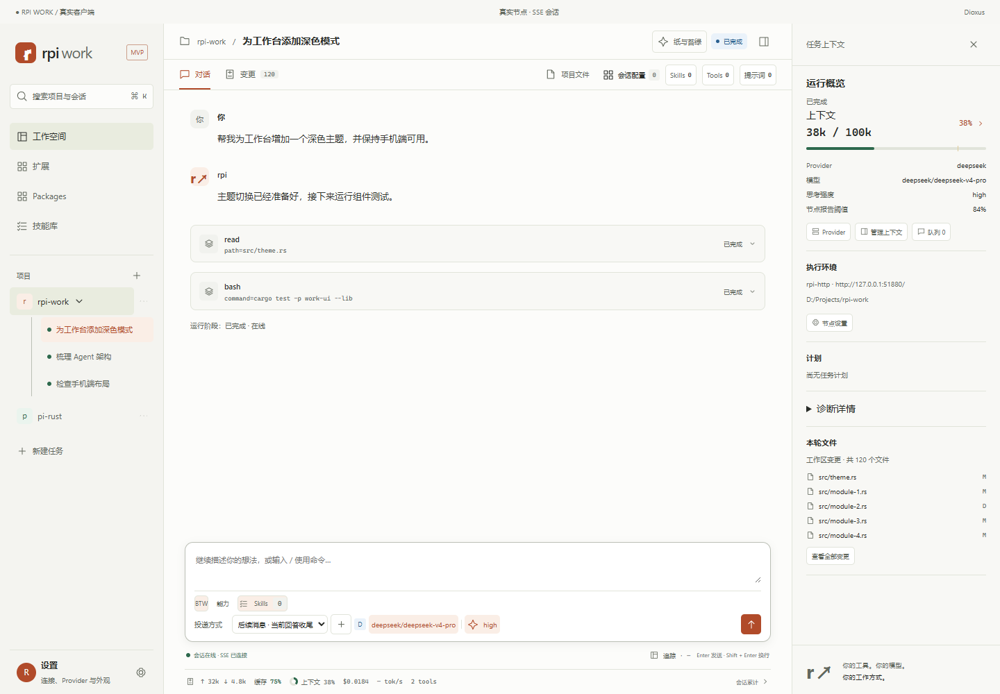
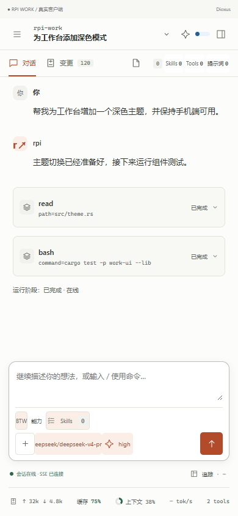

# RPI Work

用 Rust + Dioxus 构建的个人 Agent 工作台。在桌面和手机上访问同一个执行节点，围绕项目完成对话、工具执行、文件预览和代码审阅。

[下载最新版](https://github.com/pi-rust/rpi-work/releases/latest) · [全部版本](https://github.com/pi-rust/rpi-work/releases) · [构建状态](https://github.com/pi-rust/rpi-work/actions/workflows/build.yml) · [开发与设计文档](#文档)

查看手机界面

界面截图来自正式 Dioxus 客户端的验收环境，使用示例会话、文件和统计数据。

## 下载与安装

在 [GitHub Releases](https://github.com/pi-rust/rpi-work/releases/latest) 的 **Assets** 中选择对应平台：

| 平台 | 架构 | 安装包与启动方式 |
| --- | --- | --- |
| Windows | x64 / ARM64 | 解压 ZIP，运行 work-ui.exe；需要 WebView2 Runtime |
| macOS | Intel / Apple Silicon | 解压 tar.gz，打开 RPI Work.app；当前未配置 Apple 签名与公证 |
| Linux | x64 / ARM64 | 解压 tar.gz，运行 work-ui；基于 Ubuntu 24.04，依赖 GTK 3 / WebKitGTK 4.1 / libxdo |
| Android | ARM64 | 安装 APK；最低 Android 7.0，使用固定签名以支持后续覆盖升级 |
| Web | WASM | 解压 Web ZIP，由静态服务器或兼容的 rpi-web 托管 |

每个平台提供 SHA-256 校验文件；Release 另含供客户端验证的 update.json 和 update.json.sig。桌面包同时包含 work-cli。详细依赖与打包方式见 [多平台编译说明](docs/guides/ci-builds.md)。

Android 0.1.0 使用临时开发签名，首次迁移到固定签名版需要卸载重装，手机本地偏好会清除；电脑节点上的项目和会话保留。iOS 尚未提供安装包。

## 快速开始

### 1. 桌面使用本机；Web 默认是同一桌面的入口

v0.1.9 已正式发布，包含本机 `rpi-extcore` 路径：原生桌面默认在进程内使用纯 Rust 的已发布 `rpi-extcore =0.1.5`，由它通过 stdio `rpi --mode rpc` 执行 Agent 与控制操作。桌面不需要、也不会启动 `rpi-http`，没有本机 HTTP 登录步骤。只需安装兼容的 `rpi`（应用可执行文件旁或 PATH；也可用 `RPI_WORK_RPI_BIN` 指定），模型凭据仍在 rpi 中配置。源码后续改动不会自动升级已安装的应用；请通过 Release 或应用更新安装对应版本。

当前源码的 Web 默认使用桌面同一个 owner 的项目、会话与运行状态：打开桌面提供的 Web 地址，有效登录直接进入，否则只输入宿主密码；不用填写节点地址或点击连接。Android 原生 App 通过桌面的一次性授权二维码进入。源码变化不自动替换已安装／正在运行的旧版本，详见下方桌面 HTTP 入口。

只有需要另建独立节点时，才在项目目录显式运行以下命令；这不是默认 Web 或桌面的启动前置：

~~~shell
rpi-http --project . --rpi-bin rpi --port 13030
~~~

从源码启动节点时，在 rpi-package 仓库执行：

~~~shell
cargo run --locked -p rpi-http -- --project <项目目录> --rpi-bin <rpi可执行文件> --port 13030
~~~

也可使用兼容的 rpi-web 服务；模型 Provider、凭据和工具在执行节点配置。

### 2. 连接并打开项目

1. 桌面端启动 RPI Work，自动使用本机原生工作空间（本机入口 `rpi-work://local`，不是跨设备 node ID）。
2. 需要远程执行时，进入 **设置 → 执行节点 → 连接其他节点**；可随时切回本机。
3. 打开或添加已有项目，可通过原生目录选择器选择任意当前用户可访问的目录，或输入路径；新建目录按所填完整路径创建，不受远程节点项目根目录限制。可自定义显示名称；点击项目右侧的 **＋** 直接新建会话并输入需求，无须先填写标题。全局 **新建任务** 和 `/new` 沿用当前项目；首条消息发送成功后自动生成标题，之后仍可重命名。

宿主提供的 Web（包括手机浏览器）默认使用当前入口节点：有效 Cookie 直接进入，否则输入宿主密码，再自动加载同一份项目、会话和任务；不会被其他节点历史覆盖。认证后在 **设置 → 执行节点／连接我的电脑 → 连接其他电脑** 输入目标 Web 入口，进入目标节点自己的页面独立登录，并可 **返回入口节点**。目标需提供 hosted 声明和 Web assets／同源代理；这不是跨源 API 直连或同页面多节点同时在线。独立 Web 入口保留原节点选择与认证流程。详见[宿主 Web 切换节点](docs/guides/node-connection.md#宿主-web-切换节点)。

Android 原生 App 则必须扫描宿主桌面或已登录 Web 生成的 **手机 App 扫码授权**，核对目标后免密进入；授权码 120 秒有效、单次兑换，不含长期密码，不能用普通地址二维码代替。节点需正确配置监听、Host 和认证；暂不提供设备审批、逐设备权限或项目 ACL。详见[节点连接交互](docs/guides/node-connection.md)。

项目及会话的 **…** 菜单提供重命名、归档、恢复和分支操作；会话支持置顶、Fork 与 Clone。项目归档只收纳本设备侧栏，会话归档保存到节点，均不删除文件或历史。等待回复显示 loading；在底部时跟随流式输出，上翻后暂停，点击“最新消息”恢复。详见[项目、会话与消息交互](docs/guides/codex-interactions.md)。

源码当前新增桌面同 owner 的认证 HTTP/SSE：`rpi-work://local` 与内嵌 `work-server` 持有同一个工作空间，不再以桌面改连独立 HTTP 代替共享。默认监听 `0.0.0.0:13031`，仅首次缺少共享偏好时默认开启；已保存的关闭选择及无效偏好仍保持关闭。允许共享时，浏览器使用可达的同源 Web/代理地址及密码登录，Android 原生 App 使用专用一次性授权码。关闭共享不停止本机任务，也不影响桌面访问其他节点。右侧执行环境与会话导航明确区分本机/远程工作空间。已发布或正在运行的旧二进制不会因此动态增加 listener。详见[桌面 HTTP 入口](docs/guides/desktop-http.md)。

桌面可显式连接其他节点，并保留历史选择；`task desktop` 默认明确选择本机。切换视图不停止节点或任务，退出才清理 children 和数据锁。独立 standalone `rpi-http` 与旧迁移副本保持原状，不自动倒回或合并。

开发预览：配置本机 Git ignored `.env.local` 中的 `RPI_WORK_HTTP_PASSWORD`（兼容 `RPI_HTTP_PASSWORD`），运行 **`task dev`**，它并行启动桌面 owner 和 Web 热刷新（14180 → 桌面13031），不需要另开 `task desktop` 或 `task node`。`RPI_WORK_HTTP_PORT` 同时控制该桌面端口与代理目标，`PORT` 修改 Web 端口。Web默认hosted，认证后自动显示同一桌面会话；直接启动dev-web也默认指向桌面13031。显式独立Web须设置 `RPI_UI_ENTRY_MODE=standalone` 及目标API端口。只需兼容 rpi，无需相邻 rpi-package 源码；`task node` 才保留为明确独立节点。配置与真实模型验证见[真实节点聊天](docs/guides/live-chat.md)。

### 3. 更新客户端

**设置 → 应用更新** 默认在启动时及每 6 小时检查最新稳定 Release，可关闭自动检查或手动检查。下载后验证清单签名、文件大小和 SHA-256：

- 桌面：安装并重启，失败时尝试回滚。
- Android：校验包名、版本和签名证书后，由系统确认安装。
- Web：电脑服务端部署新版本后重新加载页面。

会话运行中或保留未发送草稿、附件时暂停安装。详见 [自动更新与签名发布](docs/guides/automatic-updates.md)。

## 主要能力

- **项目与会话**：侧栏添加项目、项目「＋」或全局「新建任务」创建会话；支持显示名称、搜索、重命名、归档恢复、置顶、Fork / Clone 和历史恢复。
- **对话与工具**：工作空间内流式回复、工具调用与输出、节点提供的计划和 ask 确认、停止与断线恢复；队列操作以节点支持及回读为准。消息中的 Mermaid 围栏可离线绘图，保留源码与复制。
- **执行后端**：已接入桌面本机 RPI / Claude / Codex / OpenCode 与会话持久绑定，**入口为「会话配置 → 执行后端」Tab，聊天框内不显示后端菜单和 ACP 配置控件**；切换后端须确认另建会话，原会话和草稿保留。ACP 依赖本机 adapter 与登录，Web / 远程不启动本机 ACP；Claude 已完成短提示实测，Codex / OpenCode 尚仅通过握手和建会话，详见 [ACP 使用与验收](docs/guides/acp-backends.md)。
- **BTW 旁问**：输入区打开独立普通会话，有独立历史与取消；发送前须确认节点 active tools 为空，不自动读取主对话，显式引用只写入主草稿。不是原生 BTW 插件加载。
- **文件与变更**：工作空间「变更」和项目文件入口提供文件树、内容预览、Git 状态与 diff、多文件搜索和筛选、移动端列表与详情。
- **运行信息**：任务上下文与会话追踪展示队列、上下文压缩、耗时，以及节点实际报告的 token、缓存和费用；请求已接受不等于任务已完成。
- **会话能力与资源库**：侧栏能力库（扩展 / Packages / 技能库）和会话资源配置支持设计包导入导出、预览和版本选择。扩展固定版本是 **desired**，不代表节点 **applied**；UI 可见性独立于 Agent 配置，通用安装、加载及 applied 协议尚未接入。
- **元Agent**：添加项目时选择元Agent用途，再从项目导航进入；支持个人源码草稿、结构校验、不可变测试快照和个人设计版本。结构检查不编译或执行源码，发布不安装或启用节点插件；真实开发会话也不会自动写回草稿。
- **附件预览**：输入区可选择并本地预览支持的图片 / 文本及显式文本引用；尚未接入附件上传或直接发送图片给模型。
- **外观与设置**：顶部「外观与主题」提供 Codex 黑白及原四套主题，共五套预设，支持浅色 / 深色 / 跟随系统、密度和主题 JSON 导入导出；工具展示可跟随主题或选择简单 / 详情，默认简单。设置中可管理执行节点与应用更新。完整视觉参数通过 JSON 编辑，尚无逐字段可视化编辑器。

当前入口与能力边界见 [项目、会话与消息交互](docs/guides/codex-interactions.md)、[执行后端说明](docs/guides/acp-backends.md)及 [扩展架构](docs/architecture/extensions.md)。视觉打磨不补齐通用节点协议；本机 ACP 接入也不表示远程节点新增了 Agent 启动或资源安装协议。

当前源码通过 `WorkspaceClient` 统一桌面本机原生工作空间与远程 HTTP/SSE：本机项目目录、目录索引、文件和 Git 由本地 Rust 服务提供，不虚构 RPC wire 方法；本机 RPI 执行与控制走 stdio RPC，所选本机 ACP 后端走隔离托管的 stdio ACP。Web、Android 与显式远程连接仍使用认证 HTTP/SSE。本机目录索引为 `<data>/rpc/projects.json`，会话注册表为 `<data>/rpc/projects/<id>/sessions.json`；旧应用目录索引与匹配项目的注册项可导入，源文件保留，不改写 transcript，不承诺全局原生历史发现。节点资源安装、逐设备授权、直接向模型发送图片等能力仍有协议缺口；附件本地预览不等于模型多模态输入。HTML 原型中的演示状态不代表后端已实现。历史功能边界见 [上游功能审阅](docs/archive/upstream-functional-review.md)，当前传输边界见 [transport 架构](docs/architecture/transport.md)。

## 从源码运行

安装 stable Rust 和对应平台依赖，克隆仓库后执行：

~~~shell
cargo run --locked -p work-ui
~~~

检查代码：

~~~shell
cargo fmt --all -- --check
cargo test --workspace --locked
cargo clippy --workspace --all-targets --locked -- -D warnings
~~~

CLI 默认连接已运行的桌面／无头节点 `http://127.0.0.1:13031/`，不再默认启动独立 Agent。客户端密码从 `RPI_WORK_PASSWORD` 或 `--password-stdin` 读取，每次命令独立认证，不保存明文凭据或跨命令 Cookie：

~~~shell
cargo run --locked -p work-cli -- --help
cargo run --locked -p work-cli -- projects
cargo run --locked -p work-cli -- sessions
cargo run --locked -p work-cli -- watch SESSION_ID
~~~

无头宿主先安全注入非空 `RPI_WORK_HTTP_PASSWORD`，再运行 `cargo run --locked -p work-cli -- serve`；桌面也支持 `work-ui --headless`。两者复用 GUI 的同一 owner、数据目录与锁，不创建第二套会话库。服务器只构建 `work-cli` 即可，不依赖 Dioxus/WebView。桌面连接已运行宿主用 `work-ui --connect http://127.0.0.1:13031/`，不再另建本机 owner。

目标可由 `--url` / `--node` 或 `RPI_WORK_URL` 指定（独立旧节点13030须显式设置）。旧 RPC／ACP 直接启动诊断仅保留为显式 `RPI_WORK_TRANSPORT=rpc|acp` 模式。CLI 的 `prompt` 受理 ACK 不代表结算，退出客户端不停止 owner 任务；详见[无头节点与统一 CLI](docs/guides/headless-node.md)。Web 开发工具位于 `tools/dev/`，跨平台打包脚本位于 `scripts/ci/`，见 [本机构建步骤](docs/guides/ci-builds.md#本机复现)。

复验入口与产物规则见 [测试说明](docs/guides/testing-artifacts.md)。此前会话分层迁移、Android 双 ABI 编译补验和视觉审阅的结果保存在 [历史记录](docs/archive/README.md)，只对应各次构建，不代表当前源码、已安装应用、原生 GUI 或真机自动通过。

### 代码结构

| 目录 | 职责 |
| --- | --- |
| apps/work-ui | Dioxus 桌面、Android 与 Web 客户端 |
| apps/work-ui/src/app | 启动、工作空间协调、连接生命周期和会话标识 |
| apps/work-ui/src/features | 对话、项目、资源、元 Agent、设置和可观测性 |
| apps/work-ui/src/shared | 公共组件、状态辅助与主题 |
| apps/work-cli | 现有节点认证、typed 会话操作／订阅、无头宿主入口及显式原生诊断 |
| crates/work-core | 纯共享 DTO、typed NodeApi、会话能力/配置契约和事件投影 |
| crates/work-client | WorkspaceClient 本机 / 远程访问适配、HTTP/SSE、连接恢复与客户端投影 |
| crates/work-node | 唯一 workspace owner、RPC/ACP 执行、会话绑定、数据锁与生命周期 |
| crates/work-component-api | 通用组件包契约、校验、目录/授权与隔离面板通信桥 |
| crates/work-http-component | 远程访问专用面板与动作映射（监听 IP/端口、分享地址、新密码） |
| crates/work-server | 同一节点 owner 的受保护 HTTP/SSE 与可选 Web assets |
| crates/work-host | GUI／无头共用宿主、HTTP 配置与协作退出；无 Dioxus/WebView 依赖 |
| crates/work-update | 更新发现、签名验证、下载与安装助手 |
| assets/vendor | 正式客户端使用的二维码、Mermaid 库及许可证 |
| design/prototype | 保留内容与校验基准的 HTML 设计参考 |
| tests | 集成测试、原型测试、模块验证入口及 fixture |
| tools/dev、tools/review | 本地开发、截图对照和诊断工具 |
| docs/guides、docs/architecture、docs/design、docs/reviews、docs/archive | 当前指南、源码边界、设计、专题审查和历史记录 |

目录职责、依赖边界和常用入口见 [项目结构](docs/guides/project-structure.md)。Node.js 与 `tools/package.json` 只用于开发和浏览器验证，不是客户端运行时依赖。

## 构建与版本发布

| 触发方式 | 结果 |
| --- | --- |
| 推送 main / master、PR、手动 Run workflow | 检查并构建八个平台制品，上传 **Actions → Artifacts**，保留 14 天 |
| 推送与 UI 版本一致的 v* 标签 | 全部构建成功后，上传安装包、校验文件和签名清单到 **GitHub Release** |

主分支构建成功不会自动创建 Release。发布稳定版本时，先更新 apps/work-ui/Cargo.toml 和 docs/release-notes.md，提交后打标签：

~~~shell
git tag -a v0.1.9 -m "RPI Work v0.1.9"
git push origin v0.1.9
~~~

标签中的版本必须与 UI 包版本一致。发布任务先创建草稿，上传完整制品并验证签名，最后公开 Release，供客户端下载和自动检查更新。签名配置、失败排查和密钥备份见 [发布说明](docs/guides/automatic-updates.md#发布流程)。

## 文档

- **产品与架构**：[产品范围](docs/design/product-design.md) · [架构与传输](docs/architecture/transport.md) · [节点与会话归属](docs/design/node-session-ownership.md)
- **使用与连接**：[对话、项目和文件审阅](docs/guides/codex-interactions.md) · [ACP 后端](docs/guides/acp-backends.md) · [节点连接与扫码](docs/guides/node-connection.md) · [主题视觉规格](docs/guides/theme-design.md)
- **能力与扩展**：[Agent / UI 扩展边界](docs/architecture/extensions.md) · [开发 Demo](docs/guides/extension-demo.md) · [产品与资源共识](docs/design/头脑风暴文档.md) · [资源契约提案](docs/design/session-resource-contract.md)
- **开发与验证**：[开发规范](docs/guides/development-standards.md) · [项目结构](docs/guides/project-structure.md) · [多平台编译](docs/guides/ci-builds.md) · [自动更新](docs/guides/automatic-updates.md) · [测试与产物](docs/guides/testing-artifacts.md)
- **完整索引与历史**：[文档导航](docs/README.md) · [旧方案、迁移及验收归档](docs/archive/README.md)

查看冻结的 HTML 原型：在仓库根目录运行 `python -m http.server 14173 --bind 127.0.0.1`，打开 <http://127.0.0.1:14173/design/prototype/>。原型使用示例数据，不是正式应用或已实现能力的证明。

节点组件的自定义界面、下载安装与组合边界见[组件组合架构](docs/architecture/component-composition.md)。物理边界：rpi 能力在 rpi/extcore，HTTP 适配在 rpi-http；Work 的节点管理、组件包和专用面板在 Work（`crates/work-component-api`、`crates/work-http-component`）。Work 的多项目 owner 不是 rpi-http 的实现；Work 不下载、选择或监督 rpi HTTP 扩展作为自己的宿主运行时，也不声称新的 rpi HTTP 插件已支持 Work 现有远程工作空间协议。
