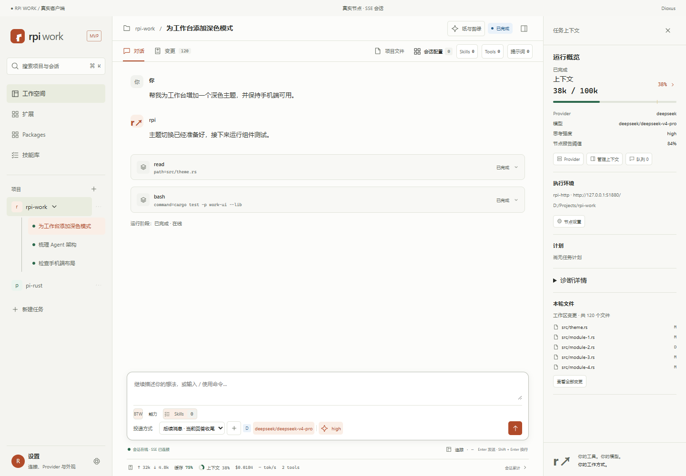
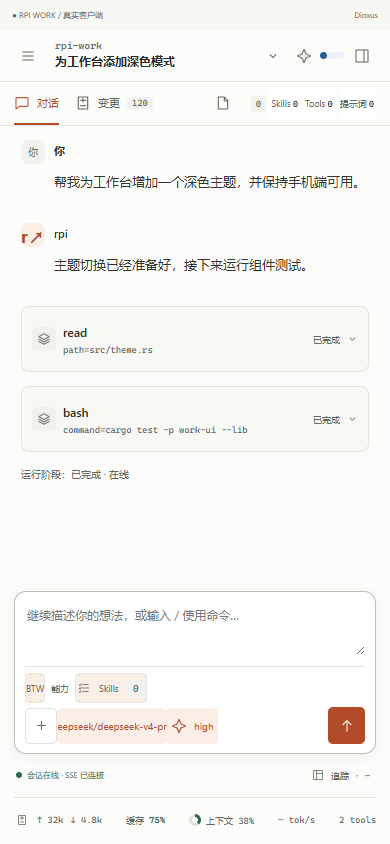

# RPI Work

用 Rust + Dioxus 构建的个人 Agent 工作台。在桌面和手机上访问同一个执行节点，围绕项目完成对话、工具执行、文件预览和代码审阅。

[下载最新版](https://github.com/pi-rust/rpi-work/releases/latest) · [全部版本](https://github.com/pi-rust/rpi-work/releases) · [构建状态](https://github.com/pi-rust/rpi-work/actions/workflows/build.yml) · [开发与设计文档](#文档)

查看手机界面

界面截图来自正式 Dioxus 客户端的验收环境，使用示例会话、文件和统计数据。

## 下载与安装

在 [GitHub Releases](https://github.com/pi-rust/rpi-work/releases/latest) 的 **Assets** 中选择对应平台：

| 平台 | 架构 | 安装包与启动方式 |
| --- | --- | --- |
| Windows | x64 / ARM64 | 解压 ZIP，运行 work-ui.exe；需要 WebView2 Runtime |
| macOS | Intel / Apple Silicon | 解压 tar.gz，打开 RPI Work.app；当前未配置 Apple 签名与公证 |
| Linux | x64 / ARM64 | 解压 tar.gz，运行 work-ui；基于 Ubuntu 24.04，依赖 GTK 3 / WebKitGTK 4.1 / libxdo |
| Android | ARM64 | 安装 APK；最低 Android 7.0，使用固定签名以支持后续覆盖升级 |
| Web | WASM | 解压 Web ZIP，由静态服务器或兼容的 rpi-web 托管 |

每个平台提供 SHA-256 校验文件；Release 另含供客户端验证的 update.json 和 update.json.sig。桌面包同时包含 work-cli。详细依赖与打包方式见 [多平台编译说明](docs/ci-builds.md)。

Android 0.1.0 使用临时开发签名，首次迁移到固定签名版需要卸载重装，手机本地偏好会清除；电脑节点上的项目和会话保留。iOS 尚未提供安装包。

## 快速开始

### 1. 在电脑上启动执行节点

RPI Work 是客户端，安装包不包含 rpi 执行宿主、rpi-http / rpi-web 或模型凭据。先在电脑或服务器安装并配置兼容节点，例如在项目目录运行：

~~~shell
rpi-http --project . --rpi-bin rpi --port 3030
~~~

从源码启动节点时，在 rpi-package 仓库执行：

~~~shell
cargo run --locked -p rpi-http -- --project <项目目录> --rpi-bin <rpi可执行文件> --port 3030
~~~

也可使用兼容的 rpi-web 服务；模型 Provider、凭据和工具在执行节点配置。

### 2. 连接并打开项目

1. 桌面端启动 RPI Work，进入 **设置 → 执行节点**。
2. 桌面本地节点填写 http://127.0.0.1:3030，受保护的节点需登录。
3. 打开或添加已有项目，可自定义显示名称；选择会话或新建任务，开始对话。

手机进入 **连接我的电脑**，扫描电脑显示的地址二维码，也可从相册识别二维码；识别后核对地址并确认连接。手机端不提供角色切换和手工地址表单。电脑默认使用本机节点，需要远程节点时在 **执行节点 → 连接其他节点** 填写地址。节点需正确配置监听地址、允许的 Host 和认证；逐设备配对和项目 ACL 尚需上游协议支持。

当前源码支持记住成功连接的节点，重开后自动尝试重连；密码登录后直接加载项目与会话。桌面可从最近连接切换节点或清除记录，密码不会写入连接记录。连接失败可重试，15秒无响应会提示超时。详见 [节点连接交互](docs/node-connection.md)。

本机 Web 客户端可通过 `scripts/dev-web.mjs` 与实际节点同源访问，支持节点认证、真实模型流式回复和对话内工具结果。启动方式及真实模型复验见 [真实节点聊天](docs/live-chat.md)。

### 3. 更新客户端

**设置 → 应用更新** 默认在启动时及每 6 小时检查最新稳定 Release，可关闭自动检查或手动检查。下载后验证清单签名、文件大小和 SHA-256：

- 桌面：安装并重启，失败时尝试回滚。
- Android：校验包名、版本和签名证书后，由系统确认安装。
- Web：电脑服务端部署新版本后重新加载页面。

会话运行中或保留未发送草稿、附件时暂停安装。详见 [自动更新与签名发布](docs/automatic-updates.md)。

## 主要能力

- **项目与会话**：打开已有项目、显示名称、会话搜索与切换、创建、重命名、fork / clone、历史恢复。
- **单一对话**：流式回复、工具调用和输出、计划、ask 确认、BTW 旁问、停止与断线恢复。
- **文件与变更**：项目文件树、内容预览、Git 状态与 diff、多文件搜索和筛选、移动端列表与详情。
- **运行信息**：队列、上下文压缩、会话追踪与耗时，以及节点报告的 token、缓存、费用等统计。
- **会话能力**：统一展示 Skills、Tools、提示词和具名 Package；支持版本配置、设计包导入导出。
- **元Agent**：个人能力开发项目，用于编写和整理 Skills、Package 与扩展草稿。
- **外观与移动布局**：四种预设主题，浅色 / 深色 / 跟随系统、界面密度和主题 JSON 导入导出。

当前版本已接入真实 HTTP/SSE 节点。节点资源安装、逐设备授权、直接向模型发送图片等能力仍有协议缺口；附件本地预览不等于模型多模态输入。HTML 原型中的演示状态不代表后端已实现。功能边界见 [上游功能审阅](docs/upstream-functional-review.md)。

## 从源码运行

安装 stable Rust 和对应平台依赖，克隆仓库后执行：

~~~shell
cargo run --locked -p work-ui
~~~

检查代码：

~~~shell
cargo fmt --all -- --check
cargo test --workspace --locked
cargo clippy --workspace --all-targets --locked -- -D warnings
~~~

CLI 可用于检查已运行的节点：

~~~shell
cargo run --locked -p work-cli -- health
cargo run --locked -p work-cli -- capabilities
cargo run --locked -p work-cli -- sessions
cargo run --locked -p work-cli -- watch <session-id>
~~~

默认节点为 http://127.0.0.1:3030/，CLI 可通过 RPI_WORK_URL 覆盖。Web / Android 构建使用 scripts/ 中的 PowerShell 7 脚本，见 [本机构建步骤](docs/ci-builds.md#本机复现)。

### 代码结构

| 目录 | 职责 |
| --- | --- |
| apps/work-ui | Dioxus 桌面、Android 与 Web 客户端 |
| apps/work-cli | 节点诊断与会话订阅命令行 |
| crates/work-core | 消息、运行状态与事件投影 |
| crates/work-client | rpi-http / rpi-web HTTP/SSE 传输 |
| crates/work-node | 本地节点进程监管 |
| crates/work-update | 更新发现、签名验证、下载与安装助手 |
| prototype | 可独立打开的 HTML 交互原型 |

## 构建与版本发布

| 触发方式 | 结果 |
| --- | --- |
| 推送 main / master、PR、手动 Run workflow | 检查并构建八个平台制品，上传 **Actions → Artifacts**，保留 14 天 |
| 推送与 UI 版本一致的 v* 标签 | 全部构建成功后，上传安装包、校验文件和签名清单到 **GitHub Release** |

主分支构建成功不会自动创建 Release。发布稳定版本时，先更新 apps/work-ui/Cargo.toml 和 docs/release-notes.md，提交后打标签：

~~~shell
git tag -a v0.1.4 -m "RPI Work v0.1.4"
git push origin v0.1.4
~~~

标签中的版本必须与 UI 包版本一致。发布任务先创建草稿，上传完整制品并验证签名，最后公开 Release，供客户端下载和自动检查更新。签名配置、失败排查和密钥备份见 [发布说明](docs/automatic-updates.md#发布流程)。

## 文档

- **产品与架构**：[功能设计](docs/product-design.md) · [Dioxus / rpi 框架](docs/architecture.md) · [上游功能边界](docs/upstream-functional-review.md)
- **对话与项目**：[流式消息](docs/streaming.md) · [多文件审阅](docs/conversation-and-review.md) · [项目文件](docs/project-files.md) · [会话追踪](docs/session-tracing.md)
- **能力与扩展**：[Skills 与交互工具](docs/skills-and-interactive-tools.md) · [会话 Package](docs/session-packages.md) · [元Agent](docs/meta-agent.md)
- **设备与外观**：[手机与电脑连接](docs/node-connection.md) · [主题](docs/themes.md)
- **构建与验收**：[多平台编译](docs/ci-builds.md) · [自动更新](docs/automatic-updates.md) · [原型还原验收](docs/ui-parity-acceptance.md) · [本地测试产物](docs/testing-artifacts.md)

查看 HTML 原型：在仓库根目录运行 python -m http.server 4173 --bind 127.0.0.1，打开 <http://127.0.0.1:4173/prototype/>。原型使用示例数据，设计稿与历史验收记录单独保留在文档中。
