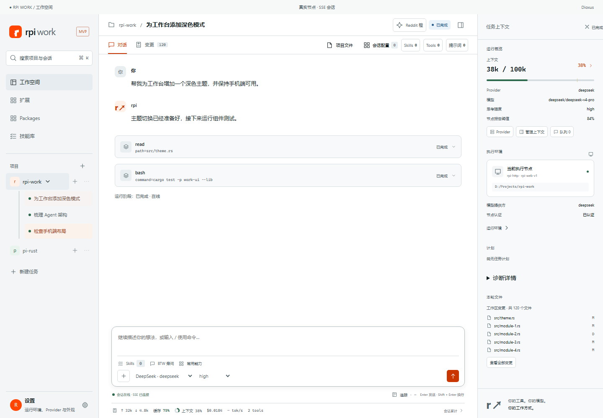
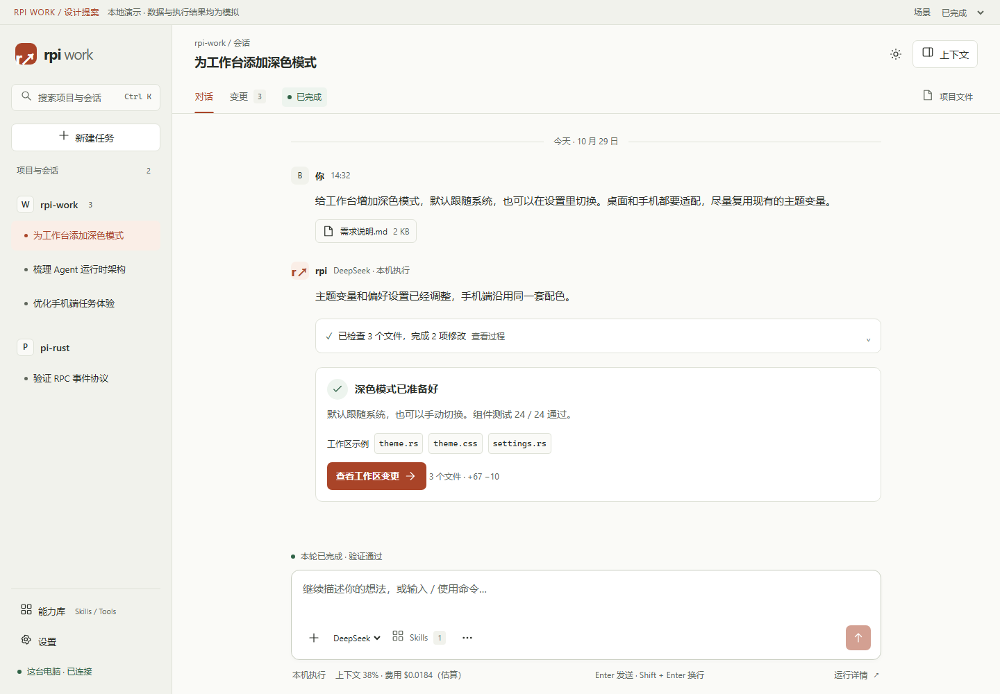

# RPI Work 界面改进建议

审阅日期：2026-10-29。目标：让用户更容易辨认当前任务、执行状态、需要处理的事项和交付结果，同时减少高频操作的视觉负担。

交付入口：[交互原型](index.html) · [验证记录](verification.json) · [验证脚本](verify.cjs)。HTML 内嵌全部 CSS/JS，可直接在本地浏览器打开，无需安装依赖或连接节点。

## 1. 结论与适用范围

建议保留现有的暖色基调，以及“项目 / 会话 → 对话 / 变更 → 上下文”的核心结构，优先调整字号、状态语义、变更范围和入口密度。当前更需要清楚的阅读顺序和操作反馈；增加装饰动画的收益有限。

本次使用 `emil-design-eng` 的信息层级、组件反馈、高频交互和动效判断原则，以及 `mobile-native` 的视口、触控与平台行为检查原则。建议中的设计尺寸是针对 RPI Work 的取舍，并非 skill 给出的统一标准。

审阅材料：

- 当前工作树的 `apps/work-ui/src/app/workspace.rs`、`app/runtime.rs`、`shared/theme/styles.css`、`features/conversation/conversation.css`、会话能力和项目审阅相关实现。
- 当前 `design/prototype/` 的现有 HTML 原型。
- 已存在的 `target/parity-web` 正式 Dioxus 客户端构建，通过仓库 `tests/fixtures/ui-fixture.cjs` 的模拟 HTTP/SSE 节点加载会话。它是正式 UI 代码的验收环境，数据与测试结果为 fixture，不是真实业务执行。
- 浏览器截图和独立原型的可重复验证。

已有构建未在本次重新编译，因此截图只证明该构建的视觉表现；实现问题同时通过当前源码核对。仓库已有较多重构与未提交内容，本次只新增本目录，未将建议应用到生产实现。

### 当前界面



### 建议原型



## 2. 已经做对的地方

- 对话和变更保持两个主要任务视图，工具结果可在对话中展开。
- `runtime.rs` 已经区分等待确认、等待结算、停止中、成功、失败和中断，存在可靠的状态模型基础。
- 主题有语义颜色和统一变量，并支持深浅主题。
- 已有 `:focus-visible`、`prefers-reduced-motion`、`100dvh`、移动端输入框 16px 和安全区处理。
- 原型和 README 对演示能力与协议缺口已有说明。应把同样的边界表达落实到具体按钮和状态中。

这些能力应保留。没有发现足够证据支持“全面重做架构”“全站动效过慢”或“缺少移动端适配”这样的结论。

## 3. 具体问题与建议

P0 表示可能影响操作判断，应先修正；P1 表示直接影响日常使用；P2 表示一致性和维护优化。证据中的名称为可搜索的源码选择器或代码片段，避免重构造成行号失效。

| 优先级 / 位置 | Before（当前） | After（建议） | Why（原因与验收） |
| --- | --- | --- | --- |
| P0 · 状态徽标 | `workspace.rs` 以 `projection.is_some()` 选择 `status-badge running`；截图中的“已完成”也使用 running 的蓝色样式。 | 用 `RunPhase` 和结算结果映射 ready / running / awaiting-input / failed / interrupted / completed 的语义样式。节点连接状态独立呈现。 | 状态文本已有区分，颜色也应匹配。完成显示成功色，失败显示错误色；断线时明确“任务状态未知”。 |
| P0 · 变更范围 | 右侧标题“本轮文件”，内部数量来自 `git_status.repository.files`，实际还显示“工作区变更”。 | 整体称为“工作区变更”；只有后端提供归属证据时才展示“本轮涉及”。 | 整个 Git 工作区可能含手动修改和其他会话修改。没有可靠归属时，不能让用户认为全部由本轮产生。 |
| P1 · 字体层级 | `styles.css` 中导航会话 11px、状态 9px；末尾 inspector 样式将环境说明和路径设为 8px，多个操作入口为 9–10px。 | 正文 15px / 1.75–1.85；导航 13px；辅助信息 12px；主标题 18px；手机输入 16px。 | 1440px 截图已有大量需要放大阅读的小字。主操作和状态至少 12–13px；路径和金额不以极小字堆放。 |
| P1 · 对话区空间 | 桌面默认 `236px minmax(0,1fr) 300px`，右侧持续展示环境、用量、计划、文件。 | 左侧约 248px，右侧默认收起；对话阅读宽度上限约 850px；上下文按需打开抽屉。 | 现有上下文可关闭，但初始权重偏高。新默认更适合长时间阅读；代价是查看环境多一次操作，可后续记忆用户偏好。 |
| P1 · 输入区入口 | 页签行有会话配置 / Skills / Tools / 提示词；输入区又有 Skills / BTW / 常用能力；页脚继续展示大量指标。 | 输入区保留附件、模型、Skills、更多、发送 / 停止；Tools、思考强度、BTW、命令和队列管理集中在更多与上下文。 | 减少重复位置。高频操作可直接点击，低频操作允许多一步；正式实现仍需保留原有功能。 |
| P1 · 移动状态 | `@media(max-width:700px)` 将 `.status-badge` 字号设为 0，只保留色点。 | 输入区上方保留一行状态文案；确认、失败和断线在对话中有具体原因与处理入口。 | 手机不能只靠颜色判断发生什么。原型中的状态行保持可见，对话内容独立滚动。 |
| P1 · 移动点击区 | 当前 mobile send 为 37 × 37px，附件约 32 × 36px，一些能力入口仅高 30px。 | 手机主操作和图标按钮达到约 44 × 44px；输入区不依赖细小图标。 | 减少误触。无需把桌面所有按钮一并放大；手机密集文字链接可用 padding 扩大实际命中区。 |
| P1 · 完成与交付 | 验收页面工具行之后是“运行阶段：已完成 · 在线”；下一步审阅入口主要依赖顶部标签和右侧文件区。 | 形成一张交付摘要：完成内容、实际验证结果、查看工作区变更入口。失败时呈现失败项与保留成果。 | 用户应能从结果直接进入下一步。摘要必须使用真实结算与工具结果，不能根据文本停止或授权成功推断完成。 |
| P1 · 确认与恢复 | 状态模型已有 `AwaitingInput`、`Cancelling`、连接恢复等；视觉表达尚可统一强化。 | 确认卡显示命令、目录、作用范围；授权后进入执行中；停止后保留停止中；断线禁发并保留草稿，重连先同步。 | 这是基于已有能力的交互规范建议，并未认定当前状态机有误。验收需覆盖两端处理同一请求与失效请求。 |
| P1 · 按压反馈 | 基础按钮有 background / color transition，未见基础层统一的 `:active` 反馈；已全局关闭 tap highlight。 | 对可按压按钮增加 `scale(.97)` 的短按反馈；减少动态效果模式取消位移。 | 移除浏览器默认反馈后，应提供自己的即时反馈。保持 100–160ms，避免让点击结果等待动画。 |
| P1 · 触控 hover | 多处直接写 `button:hover`、文件行和菜单 hover；未按输入能力限制。 | hover 视觉效果置于 `(hover:hover) and (pointer:fine)` 内，触控依赖 active 和 selected 状态。 | 从代码可确认未限制 hover；粘滞 hover 是否在目标设备复现仍需真机验证。 |
| P2 · 空计划 / 诊断 | inspector 持续展示“尚无任务计划”、诊断详情和环境元数据，即使当前任务无计划。 | 无计划时省略该块；诊断信息放到上下文的折叠区；按需查看。 | 空状态对“下一步做什么”没有帮助。失败相关诊断例外，应就近显示。 |
| P2 · 全局导航 | 工作空间、扩展、Packages、技能库与项目会话同级。 | 建议一个“能力库”父入口组织 Skills / Tools / Packages，元Agent开发入口保留在该域内。 | 减少一级概念数量。这里只是导航方案，正式迁移需核对扩展与包管理的不同生命周期，不能直接删页。 |
| P2 · 产品顶部 | 正式客户端仍显示 `.prototype-bar` 的 RPI WORK / 工作空间、真实节点 · SSE 会话、Dioxus。 | 发布界面去掉技术条；节点信息收至连接详情。设计稿保留明确的演示标识。 | 技术栈和传输协议通常不影响当前任务决策，主页面可回收约 30–34px。原型顶部条专供评审，不属于产品方案。 |
| P2 · CSS 所有权 | 共享样式后半段多次追加同一 composer / inspector / dialog 的覆盖规则。 | 在正式落地时将规则归回组件，建立字号、命中区、状态、动效的公共 token，减少重复覆盖。 | 提高改动的可预测性。这是维护风险，不能据此断言当前存在已复现的性能问题。 |

## 4. 推荐的信息架构

```text
项目与会话                      当前任务
├─ 搜索 / 新建                  ├─ 项目、任务标题、上下文入口
├─ rpi-work                     ├─ 对话 / 工作区变更
│  ├─ 会话                     ├─ 用户需求 → 过程摘要 → 交付或待办
│  └─ 会话                     ├─ 持续可见的状态 / 待发送队列
├─ pi-rust                      └─ 输入、附件、模型、Skills、更多
├─ 能力库
└─ 设置                        上下文抽屉：环境 / 用量 / 会话能力
```

桌面保留清晰的项目侧栏；移动端采用同一对象模型，以抽屉访问项目和上下文。变更在桌面为文件列表 + diff，移动端为列表 → 单文件详情 → 返回列表。代码差异容器可横向滚动，页面本身不横向溢出。

原型将模型与节点信息分别放在输入区和环境详情。正式版的 Provider、模型列表和权限能力仍应来自节点发现，不应把原型示例选项复制为固定配置。

## 5. 动效与反馈规范

| 场景 | 建议规则 | 原型实现 |
| --- | --- | --- |
| 切会话、切标签、快捷键搜索 | 即时更新，无过场动画 | 标签与会话即时；键盘打开 dialog 时禁用入场动画 |
| 按钮按压 | 约 120ms，`scale(.97)` | 使用明确的 transform transition |
| 偶发弹窗 | 约 180ms，opacity + 少量 transform；不从 scale(0) 开始 | 以 `.985` 的微缩进入，原生 dialog 管理模态焦点 |
| 提示反馈 | 约 160ms，opacity + translate；不中断输入 | 本地 toast，可被新提示替换 |
| 工具记录 | 先摘要，用户展开时即时显示 | 原生 details，未加列表逐条入场 |
| 减少动态效果 | 去掉移动、缩放和非必要动画 | 原型统一关闭 transition / animation |
| 加载与停止 | 状态真实变化优先，动画不能冒充结果 | 执行中 / 停止中 / 已中断分开；模拟定时器只用于演示 |

不建议给流式文字逐字添加淡入、给每条工具记录加 stagger、为常用导航加弹簧，或为整个抽屉持续增加模糊效果。当前没有帧率追踪证据，本次不声称某个现有动画已经造成掉帧。

## 6. 原型可体验内容与边界

打开 [index.html](index.html)，顶部“场景”可选择已完成、等待确认、执行中、连接中断、执行失败。它展示推荐方向，不替代现有的全功能原型。

可体验的闭环：

1. 在对话中展开执行摘要，进入工作区变更，切换文件并标记已审阅。
2. 切到等待确认：查看命令、目录与范围 → 允许一次 → 执行中 → 模拟结算。拒绝则进入已中断。
3. 执行中点击停止：先显示停止中，再模拟节点确认中断。输入补充内容后点击“排队”或按 Enter；从队列取回编辑或移除。
4. 断线时发送禁用且保留草稿；重连模拟先同步，再显示节点返回的结果。
5. 用 Ctrl / Command + K 搜索，搜索无结果有空态；新建本地演示任务；切会话保留当前页中的文字草稿。
6. 修改会话 Skills 选择、打开运行详情、查看只读文件、选择及移除本地附件、使用独立 BTW 旁问。
7. 在 `/help` 查看 `/new`、`/btw` 的本地演示行为。其他输入作为普通消息处理。
8. 切换浅色 / 深色；手机打开导航和上下文，单列审阅 diff；Tab 标签支持方向键、Home / End，dialog 支持 Escape 和返回触发器焦点。

边界说明：

- 所有文件差异、模型、费用、token、测试数量和输出均为演示数据。“24 / 24 通过”仅展示交付卡的结构，不是对本仓库执行测试后的结论。
- 没有真实模型、HTTP/SSE、权限授权、文件写入、安装包或部署行为。
- 当前页的会话、草稿、Skills、队列、审阅标记保存在内存；刷新会清除。文字草稿按会话保存；附件是当前输入的本地预览，切换会话会清除。
- 排队内容不会自动执行；原型明确要求取回编辑后再发送。这是一个保守的交互演示，正式接入时需遵循现有节点 steering / follow-up 的真实语义。
- 上下文提供选中数量；正式版还必须区分“用户选择”“节点已加载”“实际本轮使用”的不同证据。
- 能力库、设置和项目文件仅覆盖本次审阅所需的入口；完整的 Provider 配置、追踪、压缩、元Agent、Package 版本与节点管理沿用现有功能设计，后续另行细化。

## 7. 验证结果

通过仓库现有 Playwright / Chromium 依赖验证，记录见 [verification.json](verification.json)。执行：

```powershell
node design/emil-review-2026-10-29/verify.cjs
```

本次 12 组验证通过，浏览器无捕获的 JavaScript 错误、console error / warning。覆盖：标签键盘切换、过程展开、diff 与审阅标记、授权 / 执行 / 停止、队列、断线恢复、失败修复入口、Skills、搜索、新建、草稿、发送、输入法组合事件、附件、文件预览、旁问、移动导航、弹窗、深色与减少动态效果。

| 检查宽度 | 页面横向溢出 | 输入区位于视口内 | 备注 |
| --- | --- | --- | --- |
| 1440 × 1000 | 无 | 是 | 桌面布局 |
| 1024 × 768 | 无 | 是 | 小桌面 |
| 768 × 1024 | 无 | 是 | 窄桌面 / 平板布局 |
| 390 × 844 | 无 | 是 | 手机单栏；输入字号 16px |
| 320 × 740 | 无 | 是 | 极窄屏；标题可截断，正文可滚动 |

这不是完整无障碍认证或性能基准。可访问名称、焦点返回、键盘标签切换和减少动态效果已经做定向检查；完整屏幕阅读器路径与所有主题的对比度仍需专门验收。

移动端仍需真机检查：中文输入法候选框、软键盘弹出与收起、iOS 输入聚焦缩放、刘海与底部安全区、Android overscroll、触摸反馈与粘滞 hover。桌面设备模拟不能证明这些行为已经通过真机验收。

## 8. 落地顺序与验收标准

| 顺序 | 工作项 | 预期产出与验收 |
| --- | --- | --- |
| 1 | 修正状态样式与变更范围文案 | 直接使用既有状态模型；完成、失败、等待确认、断线区分清楚；Git 总量不标为本轮归属 |
| 2 | 字号、触控命中区和交互反馈 | 将正文 / 导航 / 辅助字形成 token；保留 focus-visible；粗指针下主要点击区至少约 44px |
| 3 | 输入区和上下文重组 | 明确每个能力的唯一主要入口；上下文收起后仍能辨认节点；切换视图不丢草稿和滚动位置 |
| 4 | 交付摘要和异常闭环 | 摘要绑定真实工具输出与最终结算；确认请求 ID 失效、两端重复处理、停止中断线都有明确文案 |
| 5 | 归拢能力导航与共享样式 | 迁移前列出现有入口映射，保持 Package / 元Agent 等功能可达；清理重复覆盖规则 |
| 6 | 真实节点与真机回归 | 复用现有 e2e / 模块测试，验证 SSE 恢复、已审阅 diff 更新后的失效、键盘和附件行为 |

建议先实现第 1–2 项，再决定是否整体采用新的输入区与上下文布局。状态语义和可读性可以独立改进，不依赖大规模页面迁移。

## 9. 截图索引

- [当前客户端](screenshots/current-desktop.png)、[原有原型](screenshots/previous-prototype.png)
- [建议桌面](screenshots/prototype-desktop.png)、[工作区变更](screenshots/prototype-changes.png)、[等待确认](screenshots/prototype-approval.png)
- [建议手机](screenshots/prototype-mobile.png)、[手机 diff](screenshots/prototype-mobile-diff.png)、[手机上下文](screenshots/prototype-mobile-context.png)、[手机深色](screenshots/prototype-mobile-dark.png)

## 10. 规则参考

- 本地 `emil-design-eng/SKILL.md`：Before / After 审阅格式；高频操作不加过场；明确的按压反馈；按目的选择动效；焦点与减少动态效果。
- 本地 `mobile-native/SKILL.md`：使用动态视口和安全区；保持输入字号；按输入能力控制 hover；触控命中与真机验收。
- 上游仓库：[emilkowalski/skills](https://github.com/emilkowalski/skills)。本文结论主要来自本项目源码与本地浏览器观察，而非对仓库介绍的概括。
