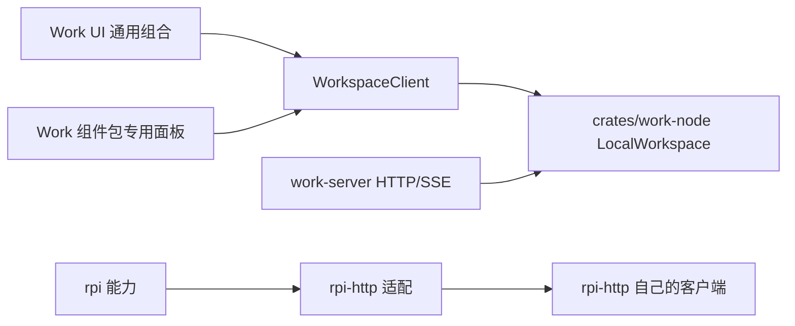

# 节点、组件与界面组合的物理边界

Work 管理节点和宿主；HTTP 扩展只把 rpi 能力服务化。三层不互相冒充：

| 层 | 位置 | 职责 | 不承担 |
| --- | --- | --- | --- |
| rpi 能力 | rpi 仓库 `rpi/extcore` | Agent 执行、项目/会话 RPC、控制操作 | Work 的多项目 owner、Work HTTP/SSE 协议 |
| HTTP 适配 | rpi 仓库 `rpi-http`（及其原生入口） | 把 rpi 能力暴露为认证 HTTP/SSE | Work 组件目录、Work 专用面板、Work 远程 UI 协议 |
| Work 节点与界面 | 本仓库 `crates/work-node`、`crates/work-server`、`crates/work-host`、`apps/work-ui` | 唯一 `LocalWorkspace` owner、节点 HTTP 入口、组件包与专用面板 | rpi 能力实现、rpi-http 的实现细节 |

`rpi-http-extension` 是 rpi 侧插件 ABI 入口，不是 Work 的“节点宿主运行时”。
Work 不下载、不安装、不选择、不监督启动这个 DLL 来充当自己的宿主，也不在
桌面归档中打包它。Work 宿主回到本进程已有的 `LocalWorkspace` 同一 owner，
HTTP 入口（`work-server`）只接在这个 owner 上。

Work 的多项目 owner 不是 `rpi-http` 的实现；不要把它描述成新 HTTP 插件，
也不要声称 rpi 的新 HTTP 插件已经支持 Work 现有的远程工作空间协议。两个仓库
的协议各自演进，需要互操作时必须先核实并显式声明，不能用“都是 HTTP”推断。



## Work 内的组件源码

专用 HTTP 设置面板和通用组件桥现在都是 Work 仓库的普通 crate，不再来自
`vendor/` 快照：

| crate | 职责 |
| --- | --- |
| `crates/work-component-api` | 组件包 Bundle/清单/面板/能力契约、校验与隔离 MessageChannel 桥 |
| `crates/work-http-component` | 远程访问专用面板（共享开关、监听 IP/端口、分享地址、新节点密码）与动作映射 |

面板布局、状态呈现和请求校验都在组件 crate 内；`apps/work-ui` 只提供通用
组件目录、安装/卸载、能力授权和按需挂载，不按组件 ID 判断 HTTP 是否存在，
也不在 UI 里再写一份 HTTP 表单。

## 组件包协议

内置包和下载安装包使用同一 Bundle、目录、面板和能力调用协议：

- 目录：`GET /api/v1/components` 返回当前节点组件；
- 安装：`POST /api/v1/components` 校验包与显式能力授权；
- 面板：`GET /api/v1/components/{id}/panels/{panel}` 返回文档，不执行代码；
- 调用：`POST /api/v1/components/{id}/call` 只调用已声明、已授权的宿主能力；
- 卸载：`DELETE /api/v1/components/{id}` 移除用户安装包。

这些接口沿用现有认证、Host/Origin、共享撤权和执行 admission。HTTP 请求不能
通过参数伪装成本机调用；本机限定的能力（例如修改共享策略）在远程侧不因
“装了 UI 包”而变成可用。面板获取返回 JSON 文档，实际执行只发生在客户端
隔离 frame 内。摘要证明内容一致性，不证明发布者身份。

设置 → 节点组件可以读取目录，按需打开专用面板，通过 HTTPS 下载或粘贴包、
检查身份与请求能力、显式授权后安装，并卸载用户安装包。组件页只安装界面包与
能力授权，不安装或加载节点宿主；它不会显示“节点运行时”来源、下次启动选择或
恢复默认运行时的操作。包清单里即使带有原生条目，也不构成 Work 在此页下载或
执行原生代码的承诺。

隔离 frame、主题令牌和 MessageChannel 动作桥不授予父页面 DOM 或凭据访问。
组件不能把本机限定的能力改成远程可用。设备页保留连接和二维码授权等通用能力。

## 远程访问专用面板

Work 的 `work-http-component` 提供共享开关、监听 IP/端口、分享地址和新节点
密码。配置由节点保存，密码只保存与现有认证一致的摘要，不进入状态响应。保存
不替换监听器、不停止任务，并明确提示下次启动生效；显式启动参数优先，其次保存
的配置，再使用环境默认值。监听配置损坏或端口冲突时，公开 HTTP 失败，本机
入口仍可修复配置。0 端口使用实际分配端口生成地址和 Host allowlist。

Work 本机入口直接访问 `LocalWorkspace`；公开 HTTP 适配同一 owner，并执行网络认证。关闭共享
撤销公开会话和连接，不停止 owner、任务或本机访问。

## 验证

结构检查与浏览器检查（不跑重型 cargo）：

```powershell
node tools/review/check-structure.cjs
node --test tests/structure/check-structure.test.cjs tests/structure/unified-ui.test.cjs tests/structure/remembered-connection.test.cjs
node tests/e2e/verify-component-panels.cjs
node tests/e2e/verify-components-workspace.cjs
```

组件与 HTTP 的 Rust 集成测试仍以各 crate 的测试为准；本页不再要求构建或加载
`rpi_http_extension` 作为 Work 宿主。原生能力是否可用由 rpi/rpi-http 自己的
验收决定，不能用 Work 的组件页或归档证明。

## 分发状态

桌面归档只包含 `work-ui`、`work-cli` 和说明文件，不包含 rpi HTTP 扩展；CI
不再强制导出或校验 HTTP 组件制品。签名 Work 自更新协议保留，`publish-release.py`
只发布 `update.json`、签名和平台归档。尚未执行发布；Windows 原生和浏览器在
本机验证，其他平台只更新构建/打包定义，不声称已在这些平台运行。
