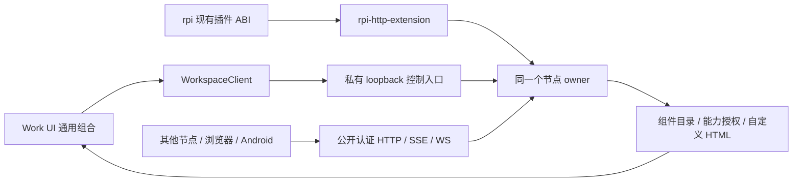

# 节点扩展与界面组合

节点、HTTP 和专用界面由 rpi-package 扩展提供。桌面 Work 启动并监督真正的
rpi 原生扩展进程，再作为客户端连接；浏览器、Android 和普通远程连接只做客户端。
沿用 rpi-plugin-sdk 的原生 ABI，不引入第二套节点 ABI。



## 源码与依赖

共享源码位于相邻 `rpi-package`：`rpi-node-api/core/host` 管理节点；
`rpi-http-runtime/node` 提供传输，现有 `rpi-http` 重新导出这些能力；
`rpi-http-extension` 是 ABI 入口；`rpi-components` 和 `rpi-http-component`
提供面板包与专用界面；`rpi-node-launcher` 提供下载暂存和原生进程监督。
本次修改使用独立 worktree
`D:/Projects/rpi-package-work-components`、分支 `codex/work-components`，避免
与主 checkout 的并发更新互相覆盖。

Work 使用 `vendor/` 下生成的源码分发快照，普通构建不需要邻接仓库。
组件源码只能在上游维护，再运行：

```powershell
python tools/dev/sync-component-packages.py --source-root ../rpi-package-work-components
python tools/dev/sync-component-packages.py --source-root ../rpi-package-work-components --check
```

快照包含内容校验目录 `vendor/component-packages.json`。内置包和下载安装包
使用同一 Bundle、目录、面板和能力调用协议。Work UI 不按组件 ID 判断 HTTP
是否存在，也不生成 HTTP 的专用表单。

## 已实现链路

- 宿主注册官方组件并绑定已有 owner；远程访问专用面板位于组件包。
- 本机 RPC facade 与认证 HTTP 使用同一组件目录，安装 UI 包不会启动 Agent。
- 设置 → 节点组件：读取目录，按需打开专用面板，通过 HTTPS 下载或粘贴包、
  检查身份与请求能力、显式授权后安装；用户安装包可卸载。
- 包身份、版本、入口、大小、摘要和路径校验；原子发布与启动恢复。
- 通用隔离 frame、主题令牌和 MessageChannel 动作桥；声明、安装授权、宿主
  能力策略分别检查，组件不能把本机限定的能力改成远程可用。
- 设备页保留连接和二维码授权能力；共享控制的专用 UI 由组件提供。

HTTP 入口：

| 方法 | 路径 | 行为 |
| --- | --- | --- |
| GET | `/api/v1/components` | 当前节点的组件目录 |
| POST | `/api/v1/components` | 校验并安装包与明确的能力授权 |
| GET | `/api/v1/components/{id}/panels/{panel}` | 获取面板文档，不执行代码 |
| POST | `/api/v1/components/{id}/call` | 调用已声明、已授权的宿主能力 |
| DELETE | `/api/v1/components/{id}` | 移除用户安装包 |

这些接口沿用现有认证、Host/Origin、共享撤权和执行 admission。HTTP 请求不能
通过参数伪装成本机调用。面板获取返回 JSON 文档，实际执行只发生在客户端隔离
frame 内。摘要证明内容一致性，不证明发布者身份。

远程访问专用面板提供共享开关、监听 IP/端口、分享地址和新节点密码。配置保存在
节点数据目录的 `http-component.json`，密码只保存与现有认证一致的摘要，不进入
状态响应。保存不替换监听器、不停止任务，明确提示下次启动生效。显式启动参数
优先，其次已保存配置，再使用环境默认值。监听配置损坏或端口冲突时，公开 HTTP
失败，私有本机入口仍可修复配置。0 端口使用实际分配端口生成地址和 Host allowlist。

## 原生启动与下载

`work-host::start()` 不创建 LocalWorkspace 或 HTTP 服务。它用共享 launcher
启动 `rpi --local-only --extension <DLL/so/dylib> --http`，验证 ready 消息、节点
身份和私有认证，然后发布 WorkspaceClient::Remote。该客户端仍明确表示本机
所有权，以保留目录选择与本机控制的能力边界。

扩展声明 `ownsStdio:true, requiresAgent:false`。rpi 的通用启动修正在
`D:/Projects/pi-rust-http-bootstrap`：不创建无关模型/Agent，继续使用原有声明和
生命周期；旧扩展不受影响。尚未发布或替换安装的 rpi。

公开 HTTP 与私有控制入口使用同一个 Arc<LocalWorkspace>，各自认证。本机控制
只绑定随机 loopback 端口，能力通过父子 stdin 管道交接，不进入 argv、环境、ready、
日志、WebView 或 Agent 子进程。公开 HTTP 不接受控制头。关闭共享撤销公开会话
和连接，不停止 owner、任务或本机访问。EOF/Ctrl+C 正常清理，监督者还拥有创建的
进程树，不能附着或清理另一个占用端口的节点。

Bundle 可选的 `manifest.runtime` 描述入口 flag 与各平台 HTTPS URL、字节数和
SHA-256。下载 UI 与执行原生代码分别授权；HTTPS 下载使用无节点凭据的新传输，
只允许有界的 HTTPS 重定向。原生文件流式限长、校验、原子暂存到内容地址路径，
再更新 selection。失败不改变已选版本，更新不覆盖正在使用的 Windows DLL。
安装结果明确要求下次启动启用，不冒称当前二进制已加载。

桌面首次缺少运行时，也可以从设置 → 节点组件检查包并下载。Web/Android 或远程
节点页面不能通过该入口安装本机原生代码。桌面安装包内置的运行时和自定义面板
采用相同协议；Work UI 不含针对 HTTP 的面板判断或表单。

运行时查找：显式 RPI_WORK_NODE_EXTENSION；已选下载包；应用同目录内置库；
rpi 已安装扩展目录。RPI_WORK_NODE_RPI_BIN 可指定服务宿主，RPI_WORK_RPI_BIN
可指定实际 Agent 执行程序；普通使用两者指向同一个 rpi。RPI_WORK_COMPONENTS_DIR
仅覆盖父端原生包缓存，节点数据锁仍由扩展持有。

## 验证

```powershell
cargo test --locked -p work-server --test components --test shared_owner --test qr_auth --test realtime_auth
cargo check --locked -p work-ui --target wasm32-unknown-unknown
./tests/e2e/verify-supervised-host.ps1 -RpiBin <支持 service-only 启动的 rpi.exe>
node tests/e2e/verify-component-panels.cjs
node tests/e2e/verify-components-workspace.cjs
```

Rust 集成覆盖真实隔离 owner、HTTP/WS、安全撤权、二维码、同一会话注册表和
监督退出。原生专项实际加载 DLL；HTTPS 暂存专项使用测试 TLS 身份下载真正的
DLL，再经 rpi ABI 启动，检查私有 API 和 EOF 清理，不调用外部模型。

正式界面专项验证使用新构建的 WASM 和真实隔离 work-host，完成官方面板打开、远程只读策略、自定义包安装、独立布局挂载及卸载；宿主通过 stdin EOF 正常退出。没有重启现有 13031 节点。

## 分发状态

开发用 `task desktop` 构建同目录原生扩展。CI 桌面归档包含扩展；
`create-component-assets.py` 汇总各平台原生文件和同一 UI，生成
`rpi-component-http.json`，发布脚本在上传前校验文件大小和摘要。尚未执行发布。
Windows 原生、WASM 和浏览器在本机验证；其他平台只更新构建/打包定义，不声称
已在这些平台运行。签名 Work 自更新协议保留；组件内容摘要仍不等于发布者认证。
