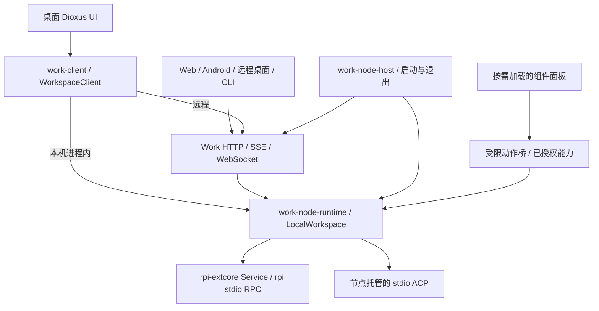

# RPI Work 架构总览

本文按 2026-11-07 的源码说明系统组成。源码能力、已发布版本和正在运行的应用分别判断；迁移经过与某次测试成绩放在归档或审查记录中。

## 系统职责

Work 是节点宿主和多端工作台。节点拥有项目、会话和执行生命周期；客户端负责访问、交互与状态投影。桌面默认同时承担宿主与客户端角色，Web 和 Android 原生 App 访问已有节点，CLI 可以连接节点或以前台方式托管节点。

rpi 提供 Agent 执行与原生资源能力。`rpi-http` 将这些能力暴露为自己的 HTTP/SSE 服务；`rpi-http-extension` 使用既有 rpi 插件 ABI 提供入口。Work 自己的多项目 owner、节点协议、共享策略和面板留在本仓库。安装 rpi HTTP 扩展不等于具备 Work 节点协议；Work 启动也不依赖该扩展。

图中的本机访问与网络入口持有同一个 `Arc<LocalWorkspace>`。每项目 Service 和 ACP manager 由这个 owner 管理；网络 adapter 不新建一份会话库。

## 物理模块与依赖方向

工作区包含 15 个成员，全部为 Work 私有包。实现位置与兼容导出名称如下：

| 模块 | 实际职责 | 依赖边界 |
| --- | --- | --- |
| `work-node-api` | 节点 DTO、typed `NodeApi`、会话能力/配置、资源和 realtime 契约 | 不依赖 UI、网络或执行宿主 |
| `work-core` | 运行状态投影、事件规范化、惰性扩展设计；重导出节点契约 | 依赖 `work-node-api`、组件契约；不持有 owner |
| `work-node-runtime` | 唯一 workspace owner、项目/文件/Git、Service、RPC/ACP、资源/源码服务和远程操作回执 | 不依赖 `work-client`、Dioxus 或 HTTP listener |
| `work-http-runtime` | HTTP 认证、Host/Origin、共享代次、二维码授权 | Work 的网络安全辅助层 |
| `work-node-service` | 将已有 owner 适配为 HTTP/SSE/WebSocket，按配置托管 Web assets | 依赖 runtime/API/HTTP 辅助层，不依赖客户端 |
| `work-node-host` | 数据锁、owner 初始化、HTTP 配置、内置组件绑定及协作退出 | 组合 runtime、service 和组件；无 GUI 依赖 |
| `work-node` / `work-server` | 分别重导出 runtime / service 的兼容门面 | 修改实现应进入实际 crate |
| `work-client` | `WorkspaceClient` 本地/远程适配，认证、传输、快照恢复与客户端投影 | 原生本地 adapter 直接依赖 `work-node-runtime`；Web/Android 不托管 owner |
| `work-host` | 面向应用的宿主门面，将已有 owner 包装为本地客户端 | 组合 `work-node-host` 与 `work-client` |
| `work-component-api` | Bundle、校验、目录、能力授权和隔离面板通信桥 | 独立于 rpi 原生插件 ABI |
| `work-http-component` | 远程访问专用界面和动作契约 | 宿主绑定真实能力，通用 UI 负责安装和挂载 |
| `work-update` | 签名更新发现、校验和平台安装 | 与 Agent/组件包分发分开 |
| `apps/work-ui` / `apps/work-cli` | 共享 Dioxus 界面 / 节点命令与前台宿主 | UI 不直接持有或启动 Agent |

`work-core::api` 和 `work-node::workspace` 等公开路径仍可使用，但源码分别在 `work-node-api` 和 `work-node-runtime`。`NodeApi` 是进程内 object-safe 应用端口，future/事件流不强制 `Send`；它不是网络协议或授权凭据。HTTP handler 适配已有 owner，不能因此假定所有操作均通过 trait 动态分发。

当前 `rpi-extcore` 锁定 Git revision `1e3c9551a054fe3bb6f2ef905429268bc4a7e5bd`，manifest 版本为 `=0.2.11`。该 revision 的内容不能用 crates.io 同版本号替换；构建不依赖相邻仓库或本机路径覆盖。依赖细节见[资源与源码服务](resources.md)。

## 启动与生命周期

| 入口 | 行为 |
| --- | --- |
| 默认 `work-ui` / `task desktop` | 创建本机 owner，桌面直接访问；尝试附加共享网络入口 |
| `work-cli serve` / `work-ui --headless` | 同一宿主工厂、数据目录和锁；要求显式非空密码，HTTP 启动失败即清理退出 |
| `work-ui --connect ORIGIN` | 纯客户端，不获取本机锁；连接失败也不回退创建 owner |
| Web / Android App / 普通 CLI 命令 | 访问目标节点，不在客户端创建执行宿主 |
| 显式 RPC/ACP CLI 诊断 | 直接使用节点 runtime 的显式诊断路径，不是默认工作台启动方式 |

每进程仅接受一次本机宿主启动尝试。`LocalGuard` 保留数据锁，退出顺序是：停止网络接收并 drain 在途操作 → 停止 workspace children → 释放 HTTP executor → 释放锁。超时或清理失败保留所有权至清理完成或进程退出。切换节点、页面离开、网络断流和关闭共享均不停止 owner 任务。

GUI 的 HTTP 启动失败仍保留本机入口以修复配置。共享开关立即撤销外部会话/连接；监听地址、端口和密码等配置保存后在下次启动生效。实现见 [work-node-host](../../crates/host/work-node-host/src/lib.rs) 与[组件组合](component-composition.md)。

## 数据与状态归属

`<data>` 是平台数据目录或显式 `RPI_WORK_DATA_DIR`。节点锁定 `<data>/node.lock`，项目目录在 `rpc/projects.json`，各项目会话注册表在 `rpc/projects/<id>/sessions.json`；ACP 绑定及 checkpoint 在 `rpc/agent-sessions.json`。持久化 node ID、共享偏好、监听配置和组件目录也属于节点。

原生 transcript、配置、revision 和恢复事实由 extcore/rpi 管理。Work 源码草稿及 provenance 在 `<project>/.rpi/work-authoring`；客户端主题、草稿、连接历史、UI 显示偏好是端侧状态。客户端缓存不成为第二份执行事实来源。

节点身份与地址分离：`rpi-work://local` 是本设备入口 key；health 中的 `nodeId` 是节点标识。当前客户端仍按地址隔离缓存/凭据，尚未自动合并同节点的多个地址，也没有同时在线的多节点调度。

## 三条可扩展路径

| 路径 | 当前能力 | 事实来源 |
| --- | --- | --- |
| 原生 Package / Skill / 扩展 | 目录、管理、精确会话选择、配置应用/恢复、源码开发与真实测试 | 节点 typed 服务及 extcore/rpi readback |
| Work 组件 Bundle | 内置或下载的自定义 HTML 面板、显式能力授权、按需隔离挂载 | 节点组件目录与能力注册表 |
| `extension.design.json` | Agent/UI/combined 的惰性设计、静态预览、旧 desired pins | 设计资源库，不是原生 applied 或加载证明 |

组件面板有自己的布局，通用 UI 只组合目录、安装器和桥。原生扩展不必提供自定义 UI；安装界面包也不安装 DLL 或启动宿主。三条路径的状态和权限不可互相代替，见[扩展架构](extensions.md)。

## 执行与一致性

UI 使用 `WorkspaceClient` / typed 应用方法；执行与配置能力来自绑定会话的 `SessionAccess`、`SessionConfiguration` 和原生资源观测。能力列表不是授权，未知能力不能回退全局默认或原生句柄。

`prompt`/取消/配置请求受理与最终结果分别表达。运行以 `agent_settled` 结算，`agent_end` 只进入待结算。快照、订阅、消息分页和迟到响应按 node/session/generation/connection epoch 隔离，消息按稳定身份与序号合并，不按文本全局去重。

远端 HTTP 是认证和资源平面；会话命令/事件默认协商 WebSocket，只有认证后的发现明确不提供 realtime 才回退 HTTP/SSE。断线或写超时不能自动重发有副作用操作。完整规则见[传输边界](transport.md)与[实时通道](realtime.md)。

## 开发、分发与验证

- `task dev`：release WASM + 无头 `work-cli`，默认直接托管 `13031`，有内容哈希资源和压缩；不热更新。
- `task dev:desktop`：桌面 owner + `14180` debug Web 构建监听/刷新，API 代理到 `13031`。
- `task node`：显式独立 `rpi-http` 服务（默认 `13030`），需要其源码，不是 Work owner 的启动前置。

桌面发布包含 `work-ui`、`work-cli` 和说明文件；Work 更新使用自己的签名清单。rpi HTTP 扩展独立分发，不打包进 Work。组件 Bundle 的内容摘要不是发布者签名。

[项目结构](../guides/project-structure.md)列出开发入口；[测试指南](../guides/testing-artifacts.md)区分结构检查、单元测试、隔离 owner、浏览器、真实 Agent 和设备验收。历史测试成绩不自动覆盖新源码。本次文档核查范围与剩余架构限制见[审查记录](../reviews/architecture-review-2026-11-07.md)。
