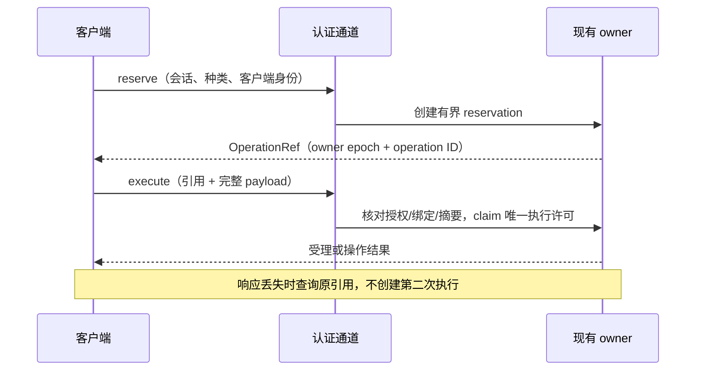

# Work 实时通道与远程操作

这是 Work 节点协议，源码在 `work-node-api::api::realtime`、`work-node-service::realtime`、runtime 的 `workspace/operations.rs` 及客户端原生/Web realtime adapter。它不扩展 rpi 原生 RPC，也不表示独立 `rpi-http` 自动实现该协议。

## 传输选择

`WorkClient` 默认为 `RemoteTransport::Auto`：

1. HTTP 负责认证、项目/文件/资源等请求，以及认证后的 `GET /api/v1/transports` 发现。
2. 支持 realtime 的节点通过 `GET /api/v1/realtime` 升级为有版本和 subprotocol 校验的 WebSocket。hello 必须与发现的节点身份、owner epoch 和能力一致。
3. 会话命令和事件订阅复用 realtime 通道；通用 HTTP 资源入口继续保留。
4. 只有明确的 `RealtimeNotAdvertised` 才允许 Auto 使用旧 HTTP/SSE。认证失败、网络错误、协议不匹配、已建立通道断开均返回真实错误，不降级后重发。

`HttpSseOnly` 和 `WebSocketOnly` 是显式选择。旧 HTTP-only fixture 应指定前者；不能放宽生产错误分类来让 fixture 通过。登录、退出、认证改变或切换模式会递增 realtime epoch 并作废旧通道。

## 认证与执行边界

WebSocket 先通过普通 Host/Origin 和认证 middleware，浏览器使用同源 Cookie；URL query 不接受临时票据或另一套认证通道。共享撤权使既有授权 lease/连接失效。升级成功不扩大项目访问、组件本机权限或会话命令能力。当前原生 realtime 客户端使用认证 Cookie（保留的私有控制兼容路径另行处理），明确拒绝 bearer-token 模式；这类 HTTP 调用方须显式选用 `HttpSseOnly`，不能假设 Auto 会降级。

消息为受校验的 JSON 文本帧。连接、订阅、请求 ID、帧大小和输出队列均有上限；心跳、空闲检测与写超时用于清理失效连接。慢客户端不能无限占用内存，也不能阻止宿主 drain。节点操作仍提交给已有 current-thread / `LocalSet` executor，socket task 不成为新的 Agent owner。

## 写操作与未知结果

远程可变操作使用 owner 级 `RemoteOperations` 回执：

预留不执行；未知或过期 ID 不能创建操作。首次执行绑定 payload 摘要，重复执行返回已有状态，内容冲突明确拒绝。许可移交 owner executor 后，连接退出不撤销已经受理的操作。

`operation_status()` 通过 HTTP 查询原回执，引用不是凭据。`OperationOutcomeUnknown` 要求核对原操作结果，不能当作失败后立即重发。回执只在当前 owner 内存中有界保留：reservation 当前为 60 秒，结果为 10 分钟；owner 重启会改变 epoch。这不是持久化 exactly-once 日志，过期/重启后的未知结果仍不能自动重放。

原生资源配置另有 extcore 管理的持久 operation ID、revision 和恢复机制，见[资源服务](resources.md)。不能用网络层短期回执替代它。

## 事件与客户端恢复

订阅携带会话与游标，规范化事件仍进入 `work-core` 投影。订阅 ready 不代表运行开始，命令 ACK 不代表 `agent_settled`。事件 gap、快照、重连 epoch 和迟到响应遵循[传输边界](transport.md)，断线后校准状态而非重发 prompt。

原生和 WASM 客户端使用同一帧契约，分别适配 socket API；UI 不按 WebSocket/SSE 复制一套业务状态机。完整实现和测试分别位于：

- [协议类型](../../crates/work-node-api/src/api/realtime.rs)
- [服务端通道](../../crates/work-node-service/src/realtime.rs)
- [owner 回执](../../crates/work-node-runtime/src/workspace/operations.rs)
- [原生客户端](../../crates/work-client/src/realtime_client.rs)、[Web 客户端](../../crates/work-client/src/wasm_realtime_client.rs)

隔离测试可以验证权限、绑定、重放和背压边界；它们不证明真实代理、安装版本或所有网络环境均已通过。
