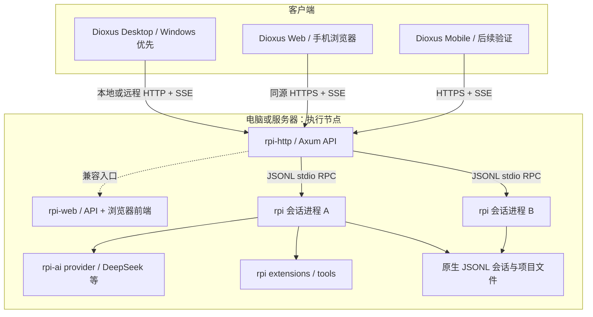

# RPI Work · 框架与实现说明 v0.9

当前源码结论：**Dioxus 共享 UI + 桌面进程内纯 Rust `rpi-extcore =0.1.5` + `rpi --mode rpc` stdio 执行宿主**。Web、Android 和桌面显式远程连接仍走认证 HTTP/SSE。桌面不需要、也不启动 `rpi-http`，没有隐式 HTTP 回退或 `RPI_WORK_TRANSPORT=http` / ACP 桌面切换；CLI 本来就默认 RPC，HTTP/ACP 仍是 CLI 的显式选项。

## 当前实现边界（源码，尚未发布）

- `WorkspaceClient` 是本机 / 远程 facade：`Local(LocalWorkspace)` 调用进程内 `rpi-extcore`，`Remote(WorkClient)` 连接 HTTP/SSE 节点。本机项目、目录索引、文件和 Git 由本地 Rust 提供，不是不存在的 RPC wire 方法；所有 Agent 执行与控制通过 stdio `rpi --mode rpc`。
- `app/bootstrap.rs` / `app/local_node.rs` 使用 `work-node::local::LocalRuntime` 解析 rpi 并持有数据锁，不启动网络服务。稳定身份 `rpi-work://local` 不是手机网络地址。Web/Android/远程连接，以及“手机连接这台电脑”的分享 / QR，都需要另行启动并正确配置可达的受保护节点。
- 桌面原生目录选择器可选任意当前用户可访问路径；新建使用所选/输入的完整路径，不限于远程节点项目根目录。远程目录访问仍受节点 API 边界约束。
- 数据默认沿用平台 `rpi-work/node`（或 `RPI_WORK_DATA_DIR`），锁为 `<data>/node.lock`；原生目录索引为 `<data>/rpc/projects.json`，每项目注册表为 `<data>/rpc/projects/<id>/sessions.json`。迁移只导入旧应用目录索引与匹配项目的注册项及偏好，保留源文件，不改写 transcript；不承诺全局原生历史发现。退出先停止 core 拥有的子进程，再释放锁。
- 已报告验证：`work-client` / `work-node` / `work-ui` 测试、desktop 与 WASM 检查，以及 rpi 0.11.0 上显式运行 ignored `local_workspace_smoke`，无模型调用。未手工测试原生 GUI 目录选择器或真实模型聊天。没有发布新二进制或升级已安装应用。

实现细节与存储迁移边界见 [transport 架构](../architecture/transport.md)，当前目录组织见 [项目结构](../guides/project-structure.md)。

## 历史设计记录（下文 v0.2–v0.9 与第 1–10 节）

以下保留早期 HTTP-first 方案、上游基线与验收设想，**不代表当前桌面默认架构或本次验证结果**。其中 standalone 监管、回环端口、打包 rpi-http、共享同一服务会话和待实现清单均按当时设计理解；当前行为以上述实现边界为准。

v0.2 数据投影与协议补充见 [常见 Agent 能力设计](runtime-interactions.md)：尤其注意 token 统计归一化、队列编辑竞争条件、图片/附件尚需扩展 RPC/HTTP 传输。

v0.3 UI 边界见 [单一对话与多文件审阅](conversation-and-review.md)：计划、工具、日志都是 ConversationView 的内联事件组件；变更采用可搜索文件列表与单文件预览。

v0.4：[Skills 与交互工具](skills-and-interactive-tools.md) 定义 QuestionRequest、SideThread 与技能发现/载入事件。ask 有现成 dialog 桥接基础；BTW 控制和 Skills 目录尚需补齐 Web 协议，不能把 TUI 支持误算为 HTTP 已支持。

v0.6：[会话资源与 Package](session-packages.md) 将 Skills、Tools、提示词配置统一放在会话顶部，引入具名可分发包、节点安装与会话启用分离、版本固定及每轮配置快照。复合包格式和会话绑定协议仍为新增提案。

v0.7：[主题系统](themes.md) 定义 `ThemeDefinition / AppearanceConfig / ResolvedThemeTokens`，以根组件 ThemeProvider 承接语义颜色、字体、形状、间距和明暗模式。主题是应用/设备偏好，与会话能力 Package 分开。

v0.8：[手机连接 PC](mobile-connection.md) 明确 PC 服务端 / 手机客户端，默认扫码、高级手工输入；两者统一到短时邀请、PC 确认、设备授权和会话恢复。逐设备授权与配对 API 需要新增，当前仅有 HTML 状态机和本地 QR 识别。

## 1. 推荐组合

**Dioxus 共享 UI + rpi-http API 服务（兼容 rpi-web）+ rpi 原生 RPC 宿主**。

首版采用现有进程边界，避免重写宿主能力。Dioxus 负责客户端，rpi-http 负责 API-only 项目/会话与传输；rpi-web 是包含浏览器前端的兼容服务入口，rpi 负责工具和模型执行。



不需要同时套 Tauri 与 Dioxus Desktop。Dioxus 自带桌面渲染/窗口方案。桌面平台代码仅承担原生目录、系统集成和节点服务生命周期。

## 2. Dioxus 为什么适合、代价是什么

官方平台文档描述 Web 使用 WASM/DOM，桌面使用原生 Rust 逻辑和 WebView；移动端也支持 WebView。原生 GPU 渲染路线仍属于实验方向。本项目选择 WebView，便于复用 HTML/CSS 设计与 Markdown/code 展示。

参考：[平台能力](https://dioxuslabs.com/learn/0.7/guides/platforms/)、[移动端](https://dioxuslabs.com/learn/0.7/guides/platforms/mobile/)、[桌面渲染器](https://github.com/DioxusLabs/dioxus/blob/main/packages/desktop/README.md)。实现阶段再核对当前稳定依赖和平台 SDK，并锁定版本；不依赖主分支实验 API。

| 维度 | Dioxus + rpi-http | Tauri + 现有 React |
| --- | --- | --- |
| 客户端语言 | Rust / RSX / CSS | TypeScript / React / CSS + Rust 壳 |
| 与现有 UI 的关系 | 组件与状态管理需要重新实现 | 可以大量沿用现有 React 界面 |
| 与现有服务的关系 | HTTP/SSE 客户端复用 API | 同样复用 API |
| 桌面和手机代码共享 | 共享 Rust UI；平台集成条件编译 | 共享 Web UI；平台功能通过壳适配 |
| 代码编辑器、终端等组件 | 需要验证 Rust 库或受控 JS 集成 | JS 生态接入更直接 |
| 主要开发代价 | 重建 UI、WASM 传输差异、调试与打包验证 | 两种语言和壳/UI 边界维护 |
| 更适合的目标 | Rust 团队的长期产品与共享类型 | 尽快从现有 rpi-web 形成桌面产品 |

这是本项目的工程判断，不承诺“零 JS”或固定包体大小。WebView DOM 桥接与某些编辑组件仍可能需要 JS。

HTML 原型中的结构、CSS token、间距与交互可以移植到 RSX；原型 JavaScript 状态逻辑要用 Rust 重写。

## 3. 本机仓库核对结果

2026-10-24 重新核对的只读基线：

- `D:/Projects/pi-rust`，提交 `daaa3cc`，workspace 版本 `0.8.3`。
- `D:/Projects/rpi-package`，提交 `450587a`，rpi-web 版本 `0.1.7`。
- 本次以工作区检出的源码为依据，两个上游工作区检查时均干净，未做 Rust 运行时兼容验证。最新结论与证据见 [功能审阅](../archive/upstream-functional-review.md)，替代此前 `90190f6 / 3409c30` 的旧基线判断。

### 可以复用的实现

| 来源 | 已观察到的能力 | 对本项目的影响 |
| --- | --- | --- |
| `rpi-http` / `rpi-web` | `rpi-http` 提供 API-only HTTP/SSE；`rpi-web` 在同一协议上附带浏览器 workspace | 当前仅用于 Web、Android 和显式远程节点；桌面默认工作空间已改为进程内 rpi-extcore，并非 HTTP workspace + RPC session 的 split lane。 |
| `rpi-http` / `rpi-web` server | Axum HTTP API、项目/会话/文件/Git、snapshot 和 SSE | Dioxus 按同一 `/api/v1` 协议接入 |
| `rpi-web/src/protocol.rs` | capability discovery、prompt、queue、abort、模型/工具设置、dialog response | UI 用 capabilities 控制按钮 |
| `rpi-web/src/host.rs` | 原生进程桥接、事件序号、挂起 dialog、结算投影 | 客户端恢复使用 snapshot + cursor |
| `rpi-http` / `rpi-web` security | Host/Origin 校验、共享密码登录、cookie 会话 | 同源 Web 接入可用；逐设备授权需新增 |
| `rpi-web/frontend/package.json` | 现有 React/TS/Vite、Markdown/highlight 组件 | 可做交互参考，不能直接转成 Dioxus Rust 组件 |
| `rpi-web/src/lib.rs` | 导出 `run` 与 `AppConfig`；内部 `run_until` 非公共接口 | 暂不假设能直接内嵌并控制完整服务生命周期 |
| `pi-rust` 各库 | provider、agent loop、tools、harness、扩展 ABI | 留在现有 rpi 宿主，后续按需求增量开放 |

本方案不把 rpi-web 插件动态加载进 Dioxus 进程。桌面监管 standalone 服务进程，或连接已经运行的服务；服务再启动 RPC 子进程。继续支持用户从 rpi 扩展入口启动同样的服务。

### 明确需要新增的能力

- Dioxus 界面、Rust 客户端类型、跨平台 HTTP/SSE transport。
- 桌面本地服务启动、就绪确认、退出策略、打包和升级。
- 逐设备配对、撤销、权限；目前共享密码不能提供设备身份隔离。
- 多节点目录、离线/弱网提示、平台通知和 PWA 资源。
- 命令幂等保护、同项目并行写保护、对审批的多端竞争处理。
- Git 按任务隔离/worktree、提交、撤销、交互式 PTY；不把现有只读 diff 误算成完整版本控制工作流。

## 4. 服务边界与数据归属

### Dioxus UI

组件：`WorkspaceShell`、`ProjectSidebar`、`ConversationView`、`ToolCallCard`、`InlinePlan`、`CommandOutput`、`ApprovalCard`、`Composer`、`ChangeWorkspace`、`ChangeFileBrowser`、`DiffPreview`、`NodePicker`、`Settings`。计划、工具与命令输出都由 ConversationView 组合，不创建独立任务标签。

只保存呈现状态、当前节点/项目/会话、消息草稿、SSE 游标。signals 仅持有投影；不能在每个 token 到达时重建整段 Markdown。原始增量批处理，消息结束再做完整解析；长历史分页/虚拟化。

### Work client

历史方案把 HTTP/SSE 与 native RPC/ACP 封装到协议中立业务 API。其间曾采用 HTTP workspace + RPC session 分流；当前桌面已由 `WorkspaceClient::Local` 完整接管本机工作空间，项目/文件/Git 也不再走 HTTP。Web/Android/显式远程节点继续使用 `WorkspaceClient::Remote(WorkClient)` 的 HTTP/SSE。UI 不直接处理 JSONL stdio，ACP 适配保留为客户端 / CLI 能力，不是桌面默认通道。

生产 Web 构建如需与 API 同源，可以使用 rpi-web 的外部 assets 配置；Dioxus desktop 或独立 API-only 部署默认连接 rpi-http。Dioxus 桌面进程的 Rust transport 直接连接节点，使用自己的 cookie jar/登录流程；不要把不受信任远程页面挂入一个具有本机工具能力的 WebView。

先确认现有鉴权在原生客户端下可用，不通过放开所有 CORS/Origin 绕过边界。不要从用户现有 Codex/RPI 会话文件偷取凭据。

### rpi-http / rpi-web

`rpi-http` 是首选的 API-only 节点，拥有项目注册、打开/关闭会话宿主、HTTP/SSE、快照、文件与 diff 投影；`rpi-web` 复用同一 API 协议并额外提供浏览器前端。第一阶段客户端遵循这套协议；需要增加的接口回到 rpi-package 上游，以独立改动处理，不在新产品中复制 server 实现。

### rpi 宿主

拥有模型认证、实际消息历史、工具运行、扩展装载、权限和 JSONL 持久化。后台执行和恢复由它决定；UI 不重放工具调用、不生成伪造的完成状态。

### 存储

继续让 rpi JSONL 存会话原始记录，rpi-web registry 存其现有索引。RPI Work 暂存外观、连接配置、配对元数据；没有需求前不引入第二套会话 SQLite 真相来源。后续确需搜索索引时，SQLite 只作为可重建索引。

凭据存节点侧环境/受保护凭据存储，客户端会话 token 使用平台合适的保护方式。移动 UI 不携带模型 provider key。

## 5. 提议的代码组织

以下是目标代码组织；当前已建立 `crates/work-core`、`crates/work-client`、`crates/work-node`、`apps/work-cli` 与 `apps/work-ui`。Dioxus UI 已具备真实节点连接和纵向 MVP，后续继续拆分组件与平台适配。

```text
rpi-work/
├── apps/work-ui/          # Dioxus 共享组件、路由、响应式布局
│   ├── assets/           # 从 HTML 原型迁移 CSS、图标
│   └── src/
│       ├── components/
│       ├── views/
│       └── platform/     # desktop/web/mobile 能力适配
├── crates/work-core/     # DTO、状态投影、命令/连接状态
├── crates/work-client/   # rpi-http/rpi-web HTTP/SSE，native + wasm transport
├── crates/work-node/     # desktop feature：服务进程监管与健康检查
├── design/prototype/            # 独立 HTML 交互稿
└── docs/
```

先保持四个边界即可，不预先拆 provider/plugin/queue/storage 等已由 rpi 处理的 crate。`work-core` 不依赖 UI；`work-client` 不包含工具执行；`work-node` 不进入 WASM 或手机编译目标。

### 概念接口（不是 rpi 已有 API，也不是可直接编译的实现）

```rust
// work-client 的设计形状；具体 async trait/Stream 类型在 PoC 后决定。
enum RuntimeKind { Rpi, Codex }

struct SessionCursor {
    node_id: String,
    session_id: String,
    last_seq: u64,
    // 序号可能随服务/宿主重启，须通过快照重新建立 epoch。
}

enum ConnectionState { Connecting, Online, Reconnecting, Offline }
enum RunPhase { Ready, Running, AwaitingInput, Cancelling, Settled }

// open_session -> snapshot -> subscribe(after=last_seq)
// submit_command(session_id, request_id, command) -> acceptance
// respond_dialog(session_id, request_id, decision) -> acknowledgement
// final completion 由事件确定，不能由 HTTP 200 决定。
```

不要为尚未接入的运行时设计完整通用巨型 trait。首版保留 `RuntimeKind` 与 capability 边界，先完成 rpi；真有第二种实现后再提取共性。

## 6. 接入现有协议

| 行为 | 观察到的 HTTP/RPC 入口 |
| --- | --- |
| 健康/能力 | `GET /api/v1/health`、`GET /api/v1/capabilities` |
| 登录/退出/刷新 | `/api/v1/auth`、`POST /api/v1/auth/refresh` |
| 项目 | `GET/POST /api/v1/projects` |
| 会话列表/创建 | `GET/POST /api/v1/sessions` |
| 打开会话 | `POST /api/v1/sessions/{id}/open` |
| 会话快照 | `GET /api/v1/sessions/{id}/snapshot` |
| 订阅 | `GET /api/v1/sessions/{id}/events?after=N` |
| 发命令 | `POST /api/v1/sessions/{id}/commands`，body 由 ApiCommand 定义 |
| 发消息/取消 | command `prompt` / `abort` |
| 队列 | `get_queue` / `queue_message` / `cancel_queued` / `clear_queue` |
| 交互确认 | command `ui_dialog_response`；具体字段遵循宿主实际 schema |
| 文件/diff | `/api/v1/projects/{id}/files`、`file`、`git/status`、`git/diff` |

协议的两条关键语义：

1. prompt response 表示 **accepted**。最终结算事件是 `agent_settled`；`agent_end` 不可独立当作终态。实际 outcome 是 completed、failed 还是 interrupted 也要检查。
2. SSE 支持 `Last-Event-ID` 或 `after`。事件缓存是有界的，服务/宿主重启可能导致序号变化。收到 `resync_required` 必须重取快照、历史与挂起 dialog，不能永远追加旧流。

建议客户端流程：获取 snapshot → 以 `lastSeq` 建立订阅 → 去重 → 应用增量。重连恢复以服务快照为准，断线不主动重复 `prompt`。现有请求 `id` 是关联标识，**本次未验证其提供服务端幂等去重**；要做到跨端可靠提交，需要新增/验证相应策略，不能承诺恰好一次执行。

同一会话当前最大并发 prompt 为 1。跨会话若指向同一目录，仍可能同时改文件；MVP 默认一个项目同时只允许一个写任务，后续再增加 worktree 隔离。锁应在节点强制执行，前端禁用按钮不足以保证一致性。

## 7. DeepSeek 与 Codex

### DeepSeek

走 rpi provider，是同一个 rpi harness 下的模型配置。用宿主模型发现接口生成选择项；不把本次查询到的具体模型 ID 永久写死。

不能因为 API 宣称 OpenAI-compatible 就假定所有消息字段兼容。官方文档要求带 tools 的思考模式保留并回传相关 `reasoning_content`；需要专门验证多轮工具调用、压缩后续跑和流式分片。见 [DeepSeek thinking mode](https://api-docs.deepseek.com/guides/thinking_mode/)。

### Codex

区分两个需求：

- 想要类似 Codex 的工作台体验：用 rpi 构建本产品即可。
- 要驱动真正的 Codex harness：后续增加 app-server 进程适配，复用产品视图，尊重 Codex 自己的会话、工具和审批。

Codex app-server 是面向自定义客户端的集成面，具有独立的线程、轮次和事件/审批协议。它不能作为一个 DeepSeek 式模型选项塞进 rpi provider。参考 [Codex App Server](https://developers.openai.com/codex/app-server/)。

认证、模型权限和费用按各 provider 官方流程处理。首版不承诺复用其他应用的登录状态。

## 8. 桌面和移动端生命周期

手机连接默认采用 [扫码或高级手工配对](mobile-connection.md)。PC 需要另行提供手机可达的受保护服务入口；下面的默认回环监听仍用于本机模式，不能仅显示二维码就认为网络服务已开放。

桌面本地模式优先监管 rpi-http standalone 子进程；需要浏览器备用界面时监管 rpi-web standalone。启动时配置回环地址与合适端口，核对启动身份、就绪、退出码；不要用固定端口假设“响应的是自己启动的服务”。

本地扩展方式 `rpi --webserver` 继续受支持，客户端也可连接用户手动启动的 rpi-http/rpi-web 节点。打包应绑定兼容版本的 rpi/rpi-http 和资源校验；只有使用浏览器 workspace 时才需要 rpi-web 前端资源。

关闭窗口与停止服务分开设计：

- 隐藏窗口到托盘且服务继续运行：手机可继续接入。
- 真正退出并停止本地服务：运行任务会受影响，保存历史不等于进程继续工作。
- 远程常驻节点：客户端退出不停止远程任务。

手机是客户端，编译时不包含 shell、动态插件加载或节点监管。Android/iOS 先验证软键盘、安全区域、WebView 生命周期、系统登录/配对回跳、前后台恢复。通知和后台 SSE 能力不能直接照搬桌面。

## 9. PoC 验收关口

在承诺 Dioxus 全量重写前，以一个真实会话验证：

1. Windows Dioxus desktop 与手机浏览器 Web 同时连接现有 bridge，能看见同一轮进展。
2. 至少数百条历史与连续长文本，输入/滚动保持可用；大 diff 延迟解析或分页，无逐 token 全量 Markdown 重建。
3. SSE 断网恢复、事件被淘汰、宿主重启、鉴权过期均恢复正确；不自动重放写工具。
4. 两端回应同一确认，节点只采纳有效的首次决策；陈旧对话框关闭。
5. 真实停止/失败/恢复状态准确，HTTP accepted 不被误当完成。
6. 原生端与 Web 端认证、文件路径、中文输入、目录选择、CSS 与资源路径正常。
7. 桌面启动/托盘/退出策略可解释；子进程不遗留，也不会误杀用户手动启动的节点。

Windows + Web PoC 通过后，再用 Android 验证共享 UI 的平台差异；iOS 构建需要相应 macOS/Xcode 环境，不能从此 Windows 原型宣称已验证。

如果核心呈现或平台集成需要大量桥接且不满足验收，用 Tauri + React 备选复用已有 UI。此判断应依据本项目测量，不能只按框架宣传或代码语言选择。

## 10. 本次设计结论

流式呈现按 [流式消息设计](streaming.md) 增补：传输连接与任务状态分开，原始消息快照/差量在 client 层归一化，core 维护有序内容块和游标，UI 增量渲染正文与工具输出。只有 `agent_settled` 决定本轮结果；断线不重发指令，恢复失效重取快照。

优先验证 Dioxus，以适配“Rust 全栈 + 多端”的长期目标；**复用 rpi-http/rpi-web 服务而非重写 agent harness**。先做一个节点和同会话接续，再扩展到设备配对与多运行时。

本次 UI 专项在保留真实 transport 的前提下，重排了 Dioxus 工作空间骨架以贴近 `design/prototype/index.html`：项目/会话导航进入 sidebar，主区使用对话 tab、消息时间线、队列 shelf 和 composer，右侧使用任务上下文 Inspector；移动端提供 sidebar drawer、quick session switcher 和文件 modal 的单列浏览。这里的“对齐”指结构、布局、视觉 token 和已有真实状态的呈现，不代表原型中尚未由服务端提供的设备、附件、Packages、Skills 或移动原生能力已经可用。
