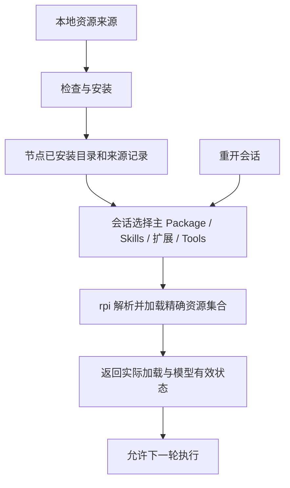

# Package、Skills 与扩展管理：基础能力梳理

> 2026-11-01 初始源码核验与实施建议；下方基线表为历史事实，不是当前功能清单。当前实现与限制见[原生资源与源码开发指南](../guides/native-resource-authoring.md)。
>
> 目标：选择一个主 Package，并按需选择独立 Skills、扩展及工具后，rpi 会话实际获得对应能力；能够查询、修改及恢复这些能力。元 Agent 后续也使用同一套机制，其开发能力由内置 Package 提供。

实施进度：阶段 A 的宿主改动已完成本地 review 与 Windows 隔离验收，提交至 [pi-rust PR #228](https://github.com/bigfish1913/pi-rust/pull/228)，commit `d0c7009cc3c33952541189cd0973921e4e0c8ffa`。新增 `--resource-config` 和 `get_resource_state`，支持精确启动选择、来源观测、原生会话绑定及重开核对；拒绝恢复前不注册扩展、不修写日志。全量 workspace 测试通过，严格 Clippy 仍受未修改基线 lint 阻断。PR 提交不代表已合并、发布或升级本机安装。下文基线表保留实施前的核验事实。

阶段 B 已完成原生本机资源管理，由 rpi 编码并独立 review，提交至 [pi-rust PR #229](https://github.com/bigfish1913/pi-rust/pull/229)，目标分支 `preview`，实现 commit `61948b41399425e252d34ecb9ee2346434fe1877`。该 PR 包含适配 preview 的阶段 A 前置提交 `c1fcfbb`，没有直接改动原 preview 工作区。新增 `resource list/inspect/install/update/reinstall/remove/recover`，支持显式全局/项目范围、纯 Skill、无 DLL Package、独立扩展及组合 Package 的完整快照，补齐归属记录、事务恢复和宿主 OS 租约保护。全量测试 2929 通过、0 失败、9 项已有忽略；原生资源测试 9 项、管理回归 13 项通过，另有独立 A/B 黑盒检查 14+18 项通过。格式与差异检查通过；Clippy 基线阻断保留，仅将一个既有默认 deny 临时降为 warning 以收齐诊断，本 PR 新增行没有告警，未加源码抑制。阶段 B 的历史交付不包含网络分发、空闲应用或 Work/extcore 接入；后续 C/D/E 接入进度见下文。原生租约按作用域保护，启动需要可写资源根目录，旧宿主及协议外文件写入不受保护。

## C/D/E 正式应用接入进度

前置链路为宿主 A/B（PR #228 / #229）→ reviewed [rpi-package PR #170](https://github.com/pi-rust/rpi-package/pull/170) → Work 同一节点所有者。Work 已将原 `=0.1.5` 依赖升级并固定至 `17ba89c0098f018db76e22051fe8c73e2792dc1c`，不是机器相邻路径或未发布版本猜测。

- **C**：typed NodeApi、节点授权/不透明资源引用、本地与 HTTP 同一所有者接入；真实基础/开发 Package 首轮加载，精确配置 CAS、操作恢复、实际加载与就绪观测、同 ID 重开历史。旧会话保持 legacy，ACP/旧宿主不支持时明确拒绝，不回退扩大配置。
- **D**：正式资源页与会话控件连接原生三类资源、全局/项目范围、安装/更新/重装/移除/恢复与显式空闲释放；区分惰性设计引用、已安装、选择、实际加载及模型有效工具。被阻止会话可只读历史，并显式重试/修正原操作。
- **E**：真实源码草稿在节点项目文件中持久化，修订/摘要 CAS、模型编辑检测、旧字节保护、受执行准入保护的保留阻塞工作者、不可变源码测试与实际成功执行证据、本地发布和另一普通会话复用。静态验证不等于测试；扩展源码不会自动编译或伪报 ABI 兼容。

真实隔离原生/回环模型验收已覆盖基础与开发包、模型写入同一草稿、Package 与独立 Skill 的真实测试/发布/复用、零工具模型请求、忙碌/过期/幂等 CAS、同 ID 重启历史和源删除后的快照稳定。独立正式 Chromium 验收覆盖源码保存/冲突/刷新、旧损坏存储保留、三类双范围资源管理、阻止历史及显式恢复和桌面/390/320 布局。证据是本地测试产物，不代表公共发布、全平台 ABI 保证或正式安装已升级。操作入口、恢复限制、测试复现及依赖说明见[当前指南](../guides/native-resource-authoring.md)。

## 1. 历史基线与初始核验边界

| 对象 | 本次核对 | 结论范围 |
| --- | --- | --- |
| Work 工作区 | `work-node` 固定依赖 `rpi-extcore =0.1.5` | 正式访问链路仍缺资源创建参数与管理接入 |
| 相邻 rpi-package 源码 | extcore 0.2.6，commit `1800195` | 新源码的 `SessionOptions`、`CreateSessionRequest` 仍无完整 Package/Skills 资源选择；不能仅升级依赖解决 |
| 相邻 pi-rust 源码 | workspace 0.16.0，commit `0b8e92f`，已有其他未提交改动 | 核查资源发现、安装、库层 setter 及 RPC 公布命令；未修改该仓库 |
| PATH 中的宿主 | `rpi --version` 返回 0.16.0 | 仅确认版本输出，未证明与上述 commit 同源 |

初始梳理时没有运行安装、卸载、重载或真实模型请求；后续验收进度见上节。0.14/0.15 的隔离实测继续参见[已有报告](../reviews/rpi-session-resource-validation.md)，不能算成 0.16 的重新运行结果。

## 2. 对象与管理范围

| 对象 | 作用 | 管理动作 |
| --- | --- | --- |
| Package | 组织一个用途的指令、Skills、扩展等资源；会话选择一个主 Package | 发现、检查内容与兼容性、安装、查询、更新、卸载、会话选择 |
| Skill | 模型可发现、按需读取的操作说明及附带资料 | 安装/导入、来源及同名冲突查询、会话选择、加载与模型可见性查询、移除 |
| 原生扩展 | 注册工具、命令、hooks 等宿主行为，也可能提供资源路径 | 获取/构建、平台和 ABI 检查、安装、加载、诊断、停用、卸载 |
| Tool | 内置或扩展注册的可调用能力 | 查询来源、会话选择、查询模型实际可调用集合；扩展提供的工具随提供者安装 |
| 指令和模板 | 指令决定持续行为；模板供显式引用或调用 | 明确 Package 的指令入口与合成规则；模板和系统指令分别处理 |

产品中的“主 Package”与当前 `rpi package` 命令并不一一对应。当前项目包命令主要围绕 Rust cdylib；Work 的 `rpi-work-design-package` 则是惰性设计文档。需要梳理并补齐原生资源结构与映射，复用现有安装记录和加载器。

尤其不能把“包里有一个 prompt 文件”解释成“已成为该 Agent 的持续指令”。指令入口、基础提示词的保留/覆盖/追加关系，以及项目上下文合成顺序必须明确并可查询。

## 3. 两条相互关联的链路



安装链路管理“本机有哪些资源”；项目链路管理“这个项目新建会话默认组合哪些资源”；会话链路管理“这一会话实际使用哪些资源”。三者不能互相冒充：项目默认组合由节点按项目身份持久化，创建 Session 时复制为不可隐式联动的会话快照。项目组合修改只影响之后新建的 Session；已有 Session 保留自己的快照，需要时通过会话级 `native_apply` 显式重启/重新加载。安装完成不自动改写全部活跃会话；卸载也不能被当成已经从运行中的进程卸载。

```text
项目资源组合（Package / Skills / Tools / 指令）
        │  创建时复制
        ▼
Session 资源快照（独立 revision / observation / host generation）
```

客户端不得从“当前选中的 Session”反推项目默认组合；节点项目资源配置接口才是新建会话的权威来源。没有项目配置时，节点继续使用 shipped/default 创建行为。

记录至少区分：已获取、已安装、已加载/注册、对当前模型有效、本轮实际使用。未知应保留为未知；Skill 可见或被读取均不证明模型遵守了全部指令。

## 4. 当前事实与缺口

| 能力 | 当前源码基础 | 需要补齐 |
| --- | --- | --- |
| 资源发现 | 宿主发现项目/全局 Skills、prompts、扩展；扩展可通过 `resources_discover` 贡献路径 | 统一目录、来源、冲突与兼容性诊断；已安装目录和加载快照分开 |
| 精确会话选择 | `--skill` 为追加；发现逻辑会合并项目/全局/包及插件来源；`--project-only` 限作用域 | 显式默认/精确选择/空选语义，防止未选资源通过自动发现或插件贡献重新混入 |
| Package 安装 | 项目 `package link/list/update/unlink`，全局原生安装已有实现 | Skills、prompts 等附带资源完整分发与记录；纯 Skill/无 DLL Package 的原生管理路径 |
| Package 指令 | 有基础系统提示词、追加提示词、项目上下文及模板加载机制 | 主 Package 指令的明确入口、来源与合成规则，避免拿模板引用模拟配置 |
| 扩展加载 | cdylib 加载、工具/命令/hooks 注册已有基础 | 按会话精确选提供者、兼容失败诊断；停用工具与停止扩展 hooks 分开 |
| 运行时修改 | harness 库有 `set_resources`、`set_tools`、`set_system_prompt`；CLI 有 reload 逻辑 | 受支持的原生会话资源操作、统一忙碌检查、应用结果及部分失败处理 |
| 工具选择 | RPC 有 `get_available_tools`、`set_active_tools` | `default / only / none`；当前空数组展开为全部工具，不能表示全部禁用 |
| 实际资源查询 | 库可读资源，RPC 可读工具；Skills 可见性依赖 `read` | RPC 返回 Skills/扩展/来源、指令组成、注册工具和真正有效工具；不能只回显选择 |
| extcore 透传 | 管理 native 子进程、会话、请求和恢复 | typed 创建/应用/查询契约、会话资源参数透传、保存恢复及执行门；0.2.6 源码亦未形成完整入口 |
| Work 接入 | UI 有 desired 选择、资源设计库，真实工具选择已有入口 | 节点侧资源目录和会话配置事实；客户端调用、回读、错误和恢复；通用扩展管理目前 Unsupported |

源码依据（均为本次核对的路径，行号随后续改动变化）：

- pi-rust：`crates/rpi-cli/src/packages.rs`（link 复制动态库、写项目 registry；`project_package_dirs` 从全部项目包派生目录）。
- pi-rust：`crates/rpi-cli/src/install.rs`（原生扩展安装及记录）；`resource_dirs.rs`、`session.rs`（来源合并、显式路径追加、指令合成）。
- pi-rust：`crates/rpi-cli/src/rpc/protocol.rs`（公布工具命令，没有完整资源查询/应用命令）；`crates/rpi-harness/src/agent_harness.rs`（资源 setter、空工具数组及 Skills gate）。
- rpi-package：`packages/rpi-extcore/src/{host,service,protocol}.rs`（SessionOptions、CreateSessionRequest、允许命令）。
- Work：`crates/node/work-node-runtime/src/workspace.rs`、`crates/client/work-client/src/extensions.rs`、`apps/work-ui/src/features/resources/library.rs`、`apps/work-ui/src/app/workspace.rs`。

## 5. 各层负责什么

| 层 | 应承担的职责 |
| --- | --- |
| rpi 原生宿主/原生安装组件 | 资源格式和解析、实际安装机制、发现/精确选择、指令合成、扩展加载与 ABI、模型有效集合、实际资源快照 |
| rpi-extcore | 中立会话资源契约、启动参数透传、native 请求、宿主生命周期、配置应用与执行互斥、资源配置保存及恢复协调 |
| work-node-runtime | 当前 workspace owner 对接中立服务；节点/项目归属、本机资源管理入口及操作协调；复用原生安装机制 |
| work-client / work-node-service | 现有本机与 HTTP/SSE 访问适配、能力协商及错误映射，传递同一套事实 |
| Work UI | 资源管理、会话选择、来源及状态展示；根据回读显示成功或失败 |

源文件和 native transcript 继续由其原有 owner 管理。通用资源恢复/执行语义优先在 extcore 形成，避免每个 HTTP/ACP/UI adapter 各做一套。

## 6. 最小契约先确定语义

以下为所需能力，不指定已有 wire 方法或 HTTP URL：

1. **资源能力与目录**：支持哪些管理动作，已安装 Package/Skill/扩展的来源、范围、实际版本/内容标识、资源明细及诊断。
2. **管理操作**：检查、安装、移除、更新的请求与可查询结果；沿用本机全局/项目范围。安装或构建原生代码前明确授权来源；权限声明本身不构成限制。
3. **会话选择**：一个主 Package、独立 Skills/扩展、工具策略及补充指令；名称相同但来源不同的资源应可区分。节点解析资源引用，前端不直接指定任意启动命令。
4. **创建/应用**：完整选择在第一次模型请求前应用；空闲修改保留历史。忙碌、重复提交、旧配置修订及两个客户端竞争有明确结果。
5. **加载快照**：会话/宿主代次、配置修订、实际来源、已加载 Skills/扩展、已注册及模型有效工具、指令来源和诊断。扩展贡献的资源也受选择规则约束。
6. **重开恢复**：保存会话选择，在新宿主上恢复并核对；缺资源或不兼容时保留历史，暂停执行并显示原因。

目录变化应使相关观测失效，运行中的资源与磁盘新内容分别呈现。移除正在被使用的资源，首版建议明确拒绝并列出引用会话；实际支持的处理策略应由原生管理机制决定。

详细并发、操作幂等、部分失败和恢复要求复用[最小契约提案](session-resource-contract.md)，无需再建立一套平行状态系统。资源安装内容的版本/来源是可诊断事实，不增加前端主导的逐会话升级审批系统。

## 7. 建议实施顺序

| 阶段 | 交付 | 验收结果 |
| --- | --- | --- |
| A：宿主契约与隔离验证 | 用真实宿主重验 0.16 基线；明确原生 Package 结构、指令入口、精确选择、资源观测及零工具语义 | 即使没有 Work UI，也能明确让 A/B 会话得到不同且精确的资源集合 |
| B：本机资源管理 | 复用并补齐原生目录、安装和卸载；支持纯 Skill、原生扩展、组合 Package | 管理结果有真实记录；组合包非 DLL 内容可达；失败不留下伪成功 |
| C：会话加载与恢复 | 宿主提供受支持操作，extcore 保存并透传配置，Work owner 对接 | 新建、空闲修改、同 ID 重开后，都能证明配置实际生效且会话隔离 |
| D：Work 正式管理入口 | 资源目录、安装/移除、会话选择、加载结果和诊断展示 | 用户在正式应用完成安装 → 选择 → 执行 → 重开；状态与宿主一致 |
| E：内置 Package 复用 | 基础能力包和元 Agent 开发包使用以上同一条路径 | 元 Agent 成为加载开发 Package 的普通受支持会话，产物可被其他会话使用 |

热重载与受控同 ID 重启先共用精确选择、快照和恢复契约。原生扩展的生命周期决定可用路径；多个 setter 不自动构成原子应用。重启可能清空插件内存，不能只按历史能打开判成功；失败不承诺撤销已经发生的扩展副作用。

## 8. 第一阶段验收用例

- 同一项目、相同全局安装环境，A/B 各用一个不同主 Package，附带不同 Skills 和扩展；模型请求收到精确集合，未选资源不混入。
- Package 的持续指令实际进入模型输入；模板只在明确引用/调用时展开；来源与冲突规则可解释。
- 单独安装 Skill、扩展与无原生库 Package；组合 Package 的附带文件完整可读。
- 验证工具 default、only、none；空选不能扩大为全部。Skill 可见性受工具策略影响时有明确诊断。
- 扩展的工具、命令和 hooks 按提供者选择；注册/加载失败不能伪报整体成功。
- 同 ID 重开保留历史且恢复选择；缺失资源、ABI 不匹配、损坏配置及应用失败不按更宽默认配置继续执行。
- 空闲修改与 prompt/队列竞争由节点统一控制；改变 A 不影响 B；安装/卸载和运行中资源引用有明确关系。

优先以本地确定性模型 fixture 检查真实系统提示词和工具 schema，以真实扩展验证注册与调用；最后补少量真实模型行为测试。仅检查前端选择、磁盘路径或 setter ACK 均不算完成。
