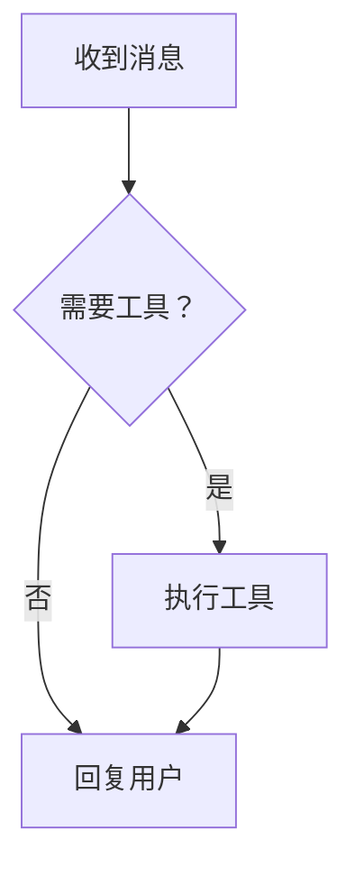

# 项目、会话与消息交互

项目右侧的「＋」直接创建会话并聚焦输入框。「…」和右键菜单管理项目或会话；菜单支持方向键、Home/End、Escape、点击外部关闭。手机菜单限制在当前屏幕内。

项目左侧的箭头独立控制展开与折叠。切换或新建会话不会收起其他项目，避免列表位移；新建会话完成后自动聚焦输入框，不抢占后来打开的菜单或弹窗。

**创建中的导航隔离**：请求提交后，切换会话／项目不会撤销可能已经成功的服务端创建，但迟到结果不会强行选回新会话。进入设置、资源页或离开对话标签也会撤销本次自动打开／聚焦意图，即便在响应前返回也不会恢复。当前连接内的成功结果仍可在项目列表找到；已离开页面的失败不覆盖当前状态或显示过期重试错误。同节点重连、换节点及 A→B→A 都通过新的连接 epoch 拒绝旧结果，不能清除新创建的忙碌状态、覆盖草稿／本地附件，也不会自动发送 prompt。

复验：`node tests/e2e/verify-session-creation-isolation.cjs` 使用两个隔离节点并显式控制 POST／详情响应的释放顺序，报告为 `artifacts/session-creation-isolation-validation.json`。此测试不代替真实桌面、Android、进程恢复或 live backend 验收；取消本地等待不代表服务端创建已回滚。

| 操作 | 当前行为 |
| --- | --- |
| 项目重命名 | 修改节点中的项目显示名称，保留目录路径与项目 ID；保存失败时保留输入，可按 Enter 重试 |
| 项目归档 | 从本设备的侧栏收纳，保留文件和全部会话；本地持久化，支持撤销和恢复 |
| 会话重命名 | 针对选定会话保存到节点；不影响正在查看的其他会话 |
| 会话置顶 | 保存到节点，在所属项目内优先显示 |
| 会话归档 | 保存到节点，从普通列表、搜索和快速切换中隐藏；历史和草稿保留 |
| 已归档 | 查看并恢复已归档项目与会话，也可打开归档会话 |
| Fork | 在会话菜单从末尾创建分支；消息旁的小分支图标使用节点提供的真实消息标识创建分支，不显示「从此处分支」文字，保留悬停说明、可访问名称与键盘操作 |
| Clone | 创建完整副本并打开；失败时保留源会话和草稿 |
| 删除 | 仍是单独的确认操作，归档及恢复从不调用 DELETE |

项目归档没有节点接口，因此只影响当前设备。会话归档和置顶使用节点持久化元数据，可由其他客户端重新读取。归档不主动停止正在运行的任务；当前对话与草稿仍可继续保留。项目显示名变化不重命名磁盘文件夹。

发送时立即显示用户消息与「正在发送…」，节点接受后显示「等待回复…」。收到正文或工具事件后，提示转为「正在处理…」并持续到 `agent_settled`；`agent_end` 或停止请求已接受都不代表任务完成。需要用户回答时，对话流显示「等待确认…」而非忙碌动画；断连时不冒充仍在正常处理。旧轮次的完成快照不会覆盖更新的运行事件。拒绝或网络失败会结束该次发送的 loading 并保留草稿，不自动重发。

任务运行中且输入框为空时，同一个主按钮**只显示停止方块**，不再叠加旋转环；点击请求停止后，按钮变为居中的单一 loading 并禁用，直到 `agent_settled` 或停止请求失败。提交指令时同样只显示一个居中 loading，尺寸与普通发送按钮一致；不会因 loading 变灰、叠图标或偏移。运行中输入新内容后，主输入框 Enter 默认按后续消息（`followUp`）入队，不重复启动主任务；停止按钮仍只用于停止，不兼作排队入口。取消过程中输入的新草稿保留，但不开放重复停止或投递。原始指令提交期间禁止重复发送，不再单独显示停止按钮。历史与流式消息共用居中的消息阅读轴，具体宽度见下节；输入区保留工作区上限。缩小消息、段落和工具卡片间距，保留移动端触控尺寸。用户消息使用轻量背景和上方「你」标识，助手正文上方使用紧凑 rpi 角色头；纯工具行不重复显示角色头。消息分支操作在鼠标悬停、键盘聚焦或触控布局中仍可使用。

在底部阅读时，正文、工具、图片尺寸和可视区域变化都会跟随滚动。上翻阅读后暂停跟随，出现「最新消息」；鼠标、触摸或 Enter 激活后立即跳到真实底部并恢复跟随，不再重复启动平滑滚动。窗口放大或工具折叠后，如果消息已全部可见，按钮自动消失；按下按钮不会因全局缩放样式移位。切换会话保留各自阅读位置；主动发送新消息回到最新位置。减少动态效果偏好下不使用 loading 动画。

## 消息与队列宽度

消息主轴、Ask 卡、输入区与底栏共用工作区宽度：默认上限 1000px，视口达到 1440px 后为 `clamp(1000px, 70vw, 1120px)`；正文段落保留自己的阅读宽度。中心轴一致。窄屏均按实际可用宽度缩小。767px 及以下同步使用侧栏抽屉、遮罩与窄屏交互；默认手机正文左右留白为 36px／24px，用户气泡实际宽度为阅读栏的 94%。

待处理消息直接显示在主输入区上方的内联面板（无障碍区域「待处理消息」），与主输入框同宽，不绑定较窄的正文阅读轴；没有队列弹窗、独立队列输入框或本地提案。无待处理消息时隐藏（错误、忙碌或历史展示除外），「收起队列／展开队列」控制列表；列表内部滚动，上限 `min(25dvh, 240px)`，手机条目操作至少 44×44px。

条目支持编辑、移除与空闲时立即发送。编辑先请求取消，只有节点明确确认取消成功后才将原文恢复到主草稿，并保留已有文字及等待期间新输入的文字；这不是原子编辑，也不会自动重新排队。移除仅取消条目，不改草稿；立即发送仅在空闲且取消成功后提交。服务端已领取或状态未知的条目不可修改，不猜测取消成功。「队列选项」内保留「刷新／清空待执行／查看历史」，不承诺暂停、重排或附件入队。

复验：`tests/e2e/verify-conversation-width.cjs` 覆盖浅深主题、桌面上下文开关及模拟非对称安全区。检查源码工作区宽度与中心、内联队列与主输入框同宽且不受局部阅读上限影响、列表限高滚动、折叠与高级操作、空队列隐藏、页面与队列无横向溢出、手机触控尺寸、草稿保留及零 prompt；报告为 `artifacts/conversation-width-validation.json`。这是正式 WASM 加隔离 fixture 验证，不是原生 WebView 或 Android 实机验收。

## 消息 Markdown 展示

- 历史与流式正文共用 escaped text/span 渲染；相邻公开消息由单向 24px 留白控制，同一消息内部正文／工具边界保留 20px，连续工具仍紧密连接。默认正文保留 15px 与较松行高，并尊重字号缩放。表格为约 13px，宽表格、代码和工具输出局部滚动。
- 普通代码块提供语言栏和「复制代码」。Rust、JavaScript／TypeScript、Python、JSON、Shell 使用本地基础词法着色，不依赖 CDN，不声明完整语言解析。未知语言、超过 64KiB 的源码或超过 4096 token 的输入整块回退纯文本，不截断显示或复制内容。代码仍保留 360px 高度上限；Mermaid 继续走原有独立安全渲染分支。
- 助手公开文本区域提供「复制 Markdown」，返回该区域的原始 Markdown，不跨工具分段合并消息。桌面 hover／键盘 focus 显示，手机常显；代码与正文复制在手机至少 44×44px。剪贴板不可用时显示失败，不放宽权限；内容更新后旧的成功提示不代表最新内容已复制。Windows 系统剪贴板读回可能将 LF 转为 CRLF，传给剪贴板 API 的源文本不因此改写。
- 仅列表项前缀 `[ ]`／`[x]`／`[X]` 转为只读任务 checkbox，不写入任务状态；混合列表中的普通项保留 bullet，正文或代码中的相同字符不转为任务。

复验：`tests/e2e/verify-message-presentation.cjs`、`verify-message-readability.cjs` 及 `tests/structure/message-layout.test.cjs`；新旧对比见 `artifacts/message-alignment-audit/REPORT.md`。Chromium、编译与 Android 实机验收分别记录。

## 失败后的继续

- 会话收到真实失败结算，或节点明确报告空闲会话 `pendingResume` 时，**空草稿且无附件**的主按钮显示实心播放三角图标（无文字），保留「继续会话」无障碍名称与恢复／发送说明；点击与 Enter 使用同一入口。普通完成、用户中断、单个工具报错、断连、活动中／取消中不据此显示继续；未回答的问题／权限请求也不能被继续绕过。
- 节点明确报告 `pendingResume` 且支持 `resume_pending` 命令时调用恢复命令，否则走普通发送路径发送一条字面文本「继续」。不重放上一条用户消息，不自动重试。两条路径均无能力时保留禁用说明，不猜测或伪造后端能力。
- 输入草稿后恢复普通发送，附件加载中或已有附件时不吞附件、不触发空文本继续；请求期间新编辑的草稿归用户所有，迟到 ACK 不清除。配置待核对时继续按钮和 Enter 同样禁用。
- 请求等待 ACK 时只允许一次提交；接受后等待真实运行及 `agent_settled`，ACK／`agent_end` 不代表完成，等待期间重复空 Enter 不再发送「继续」。恢复拒绝可手动重试；每次恢复有独立 ticket，旧请求迟到的成功／失败不能消费较新的恢复请求，会话／generation／连接 epoch 变化也隔离旧结果。
- 「继续」与普通发送／停止使用相同28px可见圆盘，播放图标12px；手机保持至少44×44px触控范围，不再使用72px文字胶囊。

复验：`tests/e2e/verify-session-continue.cjs` 的 **19 项 fixture 浏览器用例**通过，报告 `artifacts/session-continue-validation.json`；浅深主题1280／390／320px截图为 `artifacts/session-continue-{light,dark}-{1280,390,320}.png`。覆盖恢复命令与文本 fallback、键盘／双击去重、ACK与结算先后、同作用域两次恢复的迟到响应、草稿／附件、问题阻塞、能力／配置保护和连接隔离。这里的恢复命令由隔离 HTTP/SSE fixture 控制，**不是原生 RPC/ACP 或真实模型恢复验收**。

## 项目所属节点

- 项目文件夹前常显一个节点图标：本机工作空间为电脑，远程 HTTP 节点为云。云图标只说明远程连接（包括局域网、浏览器访问本机 HTTP 节点），不证明部署在公网云服务器；分类使用实际工作空间类型，不按 `localhost` 猜测。
- 图标角标反映节点级健康检查：实心绿点为在线，转圈为连接／检查中，斜杠为不可达，`!` 为未就绪或需要登录，`?` 为未确认。颜色之外保留形状、悬停说明和无障碍标签；手机仍为至少 44px 点击区域，小图标不扩大成主操作按钮。
- 悬浮可查看状态提示；点击／Enter／空格打开「节点信息」。项目与会话右键／省略号菜单也提供同一入口。查看信息不切换当前会话／项目、不改变展开状态或草稿；面板按被点击项目／会话的真实归属显示工作目录，独立会话明确标为未关联项目。
- 信息包含脱敏地址、服务／版本／协议／传输、节点认证、已报告能力数量及最近检查时间；缺失字段显示「未报告」。不显示密码、token、URL 用户信息、查询串或原始凭据错误，不虚构主机资源或云厂商。
- 每个当前工作空间共享一轮只读 `health`／`auth` 检查，初次及约每 30 秒检查一次；失败或超时不沿用绿色在线状态。可手动「刷新节点状态」，同一时间不重复检查；健康与认证读取合计预算 15 秒。时间显示使用设备本地时间，不是服务端时间或可用性保证。
- 节点可达与会话 SSE 状态分开显示：会话重连不代表节点机器离线，健康通过也不代表模型或所有 agent 可用。刷新不会重连、登录、启动任务或清空会话。切换节点／同地址重连会关闭旧面板并隔离旧请求；「节点设置」只打开现有设置页。

复验：`node tests/e2e/verify-project-node-info.cjs` 使用正式 WASM 和隔离 HTTP/SSE fixture，覆盖状态／错误恢复、周期检查、超时及迟到响应、刷新去重、节点切换／同地址重连、项目／会话菜单、独立会话、键盘焦点、草稿及明暗主题 1440／390／320px。报告为 `artifacts/project-node-info-validation.json`，不调用真实模型或写入凭据，不代替 Android 实机验收。

## 供应商与模型选择

- 主输入区入口优先显示当前供应商，完整供应商／模型保留在悬停说明与弹窗中。桌面与 Web 共用同一套主题化组件：点击后按「供应商 → 模型」展开原生折叠分组，统一箭头与选中图标；模型名称下保留节点报告的原始 ID，打开时优先聚焦可选的当前模型。Escape／关闭只退出浏览，不发送配置。
- 思考等级不再使用操作系统原生下拉，改用与 Provider 相同的主题化弹层及选中标记；展示节点实际报告的级别，保留原始值，不补造默认选项。点击当前等级／Escape／关闭不提交，关闭后恢复入口焦点。等级选项触控高度至少 44px，浅深主题与窄屏均可滚动浏览。
- 模型目录与思考等级分别加载，不因思考等级请求等待而让模型不可选。加载中、空目录、目录读取失败及能力缺失均明确提示；两个弹层均可手动刷新目录与权威运行状态。思考等级加载中／失败仍可打开查看原因并重试，不再静默吞错；真正的能力缺失／空等级仍禁用。列表不推断凭据是否有效，也不虚构供应商。
- 每次短配置读取、setter 及后续权威回读分别以 **15 秒**为限，超时退出 loading 并保留草稿，不自动重发。setter 超时，或 setter 已接受但回读发生普通错误／超时／缺失字段／空状态／不匹配／`requiresRestart`，均显示「结果待核对」并保持保护，旧显示不冒充新配置；可关闭／重新浏览、手动刷新核对，但暂时阻止新配置写入和发送／Enter（包括继续）。只有一致的成功回读，或显式刷新真实 `get_state` 报告受影响的有效非空字段，才解除保护；明确拒绝的 setter 可直接手动重试。超时不代表节点操作已取消，迟到响应不得更新选择或关闭后来打开的弹层。此期限不用于模型生成／工具运行／SSE，也不伪造结算。
- Provider 运行中允许浏览但禁止切换；思考入口在运行／能力缺失时保持禁用。模型和思考配置互斥，配置提交及回读期间禁止发送按钮／Enter，文字仍可编辑。两个 setter 均使用原始值，只有节点回读精确确认所选模型或思考等级后才更新并关闭弹窗；HTTP 接受不等于生效。明确拒绝保留重试入口；回读失败／不一致保留弹窗、草稿及核对入口；迟到的 Provider 刷新也不能覆盖更新的思考等级。
- 当前 setter 不能区分跨供应商相同的原始 ID，因此这类项明确标为不可选，不拼接或猜测 ID。迟到目录、配置及回读响应均按会话／generation／连接 epoch 隔离，同地址重连也不覆盖新状态。ACP 继续使用原有协商配置与可见性策略。
- 桌面与手机的发送／等待／停止可见圆统一为 **28px**，发送箭头 **12px**、loading **14px**、停止方块 **8px**；手机实际触控区域仍至少 **44×44px**，切换状态时不改变按钮布局尺寸。

复验：`node tests/e2e/verify-composer-model-picker.cjs` 使用正式 WASM 与隔离 HTTP/SSE fixture，覆盖分组、错误／空目录重试、能力缺失、独立发现、失败与回读校验、双击、双向配置互斥、发送保护、迟到刷新／切会话／同地址重连、草稿和明暗主题 1280／390／320px；还用浏览器时钟推进真实 WASM timer，验证目录／两个 setter／两个回读挂起、手动核对再超时及空状态不解锁。报告为 `artifacts/composer-model-picker-validation.json`；发送圆与命中区域另由 `verify-mobile-composer.cjs`、`verify-sidebar-loading.cjs` 覆盖。无真实模型或凭据调用，不替代 Android 实机验收。

## 底部状态栏插件

当前 footer 由 `apps/work-ui/src/features/observability/footer_plugins/` 的 typed 只读注册表提供，四个内置 v1 插件的设置顺序如下；会话身份默认关闭，其他默认启用：

| 插件 ID | 默认显示内容 |
| --- | --- |
| `session-identity` | 可选的当前供应商 / 模型及思考级别，默认关闭，设置中仍可启用和排序 |
| `session-usage` | **会话累计**输入/输出、缓存命中率、累计费用；速度与请求/重试仅在节点明确上报时出现 |
| `context-usage` | 当前上下文实际 token / 窗口及据此计算的比例 |
| `tool-activity` | 已加载分页历史与当前投影中的工具调用数、失败数，**不是完整会话计数**，也不是配置的可用工具数 |

- **只读，无弹窗**：指标均为普通 `span`，外层 `role="group"` 的 `aria-label` 包含完整标签、值与说明；内层 `.footer-value` 设 `aria-hidden="true"`，避免屏幕阅读器重复朗读。没有 `title`、tooltip 属性或伪元素提示，不新增 popup/Tooltip 组件。指标不是按钮或链接，没有键盘或点击/双击触发；点击或悬停均不会打开统计、上下文、工具或模型弹窗，也不会刷新或发送运行时命令。旧文档或 mock 中「点击 footer 查看统计/管理上下文」属于历史原型，不是当前行为；`RuntimeDialogs` 即使保留兼容统计 modal，footer 也没有入口。
- **旧视觉保留**：输入／输出使用共享 diff 小图标与分隔箭头数值，缓存仅已确认的数字绿色高亮，标签保持辅助色；上下文用 12px 圆环加短百分比，费用用短金额、工具用短计数（失败非零时附加失败数）。桌面右侧「会话累计」是非交互说明，不恢复点击箭头或弹层。可见短文案由 typed presentation 生成，完整累计语义、实际上下文 token／窗口、已加载调用范围仍保留在 `aria-label`。未知上下文环没有占用比例，不填造 0%。
- **配置与浏览**：进入「设置 → 底部状态栏」，或从通用页卡片进入，可启停插件、逐项显示/隐藏、上移/下移插件及「恢复默认状态栏」。排序针对插件而非单项；全部关闭或无可见项时不渲染 footer、不留占位，草稿、模型选择及发送不受影响。保留原来的窄屏布局：700px 以下隐藏费用／速度，1200px 以下隐藏右侧累计说明，默认 320／390px 核心指标无需横向滚动。显式开启身份或较多可选项、大字号时允许底栏内横向浏览兜底，不撑高、不截断原值，不依靠 tooltip 或弹层。容器自身可聚焦，左右方向键可滚动；各指标仍不可操作。插件排序优先于旧版跨插件的固定项目顺序。
- **字体与高度**：恢复旧 footer 的 mono 字体和 inline-flex 排列，数字使用 `tabular-nums`；保留当前可读字号，桌面 12px、手机 11px（不退回历史 9px 小字）。默认高度≤32px、1.5 倍字号≤44px，按单行字号自然增高而非固定高度裁切。额外项和断线提示不折行，滚动条最高 3px，不产生页面横向溢出。
- **本地偏好**：`localStorage` key 为 `rpi-work-footer-v1`，结构为 `{ version: 1, plugins: [{ id, enabled, hidden_items }, ...] }`；四个上述 ID 必须各出现一次，数组顺序决定显示顺序，默认仅会话身份关闭、隐藏列表为空。已保存的 v1 配置（包括此前全开配置）严格原样加载，不迁移、不自动重置。读取默认值不写入；损坏或不兼容记录不自动覆盖，内存调整仍可用，只有显式恢复默认才解除保护。配额/写入失败提示「仅保留在内存」，不丢当前设置，也不保证重载恢复。
- **未知不等于零**：基础指标缺失或节点/会话未确认时显示 `—`，不沿用旧 scope 的值；明确上报 0 则正常显示，包括费用、速度、请求与重试。未上报速度、请求/重试时相应项缺席；请求/重试只有一个已知时另一项为 `—`。缺失上下文 token 或有效窗口时显示未知，不从已有百分比反推 token 或推测占用比例。累计输入不是当前上下文长度，费用为节点上报累计 USD，非账单。
- **压缩入口不变**：从 inspector「查看任务上下文」→ 管理上下文（按钮「管理当前上下文」）打开「上下文与压缩」modal，继续使用原生压缩能力；只读 footer 不触发压缩。
- **插件边界**：仅支持随客户端编译的内置插件注册，不执行任意外部运行时代码或注入 manifest，不在节点安装插件，不承诺 rpi `setFooter` API。资源库 Extension 的设计预览仍不是可执行的运行时插件。

复验：`node tests/e2e/verify-footer-plugins.cjs` 使用正式 WASM 与隔离 HTTP/SSE fixture。最新 `artifacts/footer-plugins-validation.json` 的 **13/13 个用例实际全部通过**，无错误；覆盖只读无弹窗/命令、默认及可选指标、配置/排序/重载/重置、全部关闭、损坏保护、配额失败、scope/断连、缺失/零值/异常值、已加载调用、安全转义、长 ID 单行完整保留，以及触达末项／方向键滚动。明暗主题 1280／390／320px 的六张截图为 `artifacts/footer-plugins-{light,dark}-{1280,390,320}.png`；本次实测桌面默认 27px、手机 25.5px，默认核心指标无需横向滚动。新增断言覆盖 diff 图标／圆环 12px、缓存仅数值绿色、mono 字体、旧窄屏显隐、可选身份启用与旧全开配置不被改写。测试同时约束单行、默认高度≤32px、大字号≤44px、内容不被内部截断、页面不溢出，并覆盖高级指标、短键盘视口／模拟安全区，额外截图为 `artifacts/footer-style-{width}-{height}-{scale}.png`。移动输入区约束另见 `verify-mobile-composer.cjs`。这些浏览器结果不是原生桌面或 Android 实机验收，真实手机软键盘与安全区仍待验证。

## 用户输入导航时间线

会话正文的用户输入 timeline 位于**左侧**，有已加载节点时常显，不需要点击展开。正文在同侧预留空间，悬停／键盘预览向右展开。视窗**最多露出 10 个节点**（桌面24px、手机44px一步），超出部分仅在时间线内部滚动，不删除、截断或只保留前十条；短视口可以显示更少。手机使用原生上下滑动浏览，滑动不跳转正文，点击才定位；桌面继续支持滚轮、上下键／Home／End及拖动定位。导航条只在正文区域内，不覆盖输入框或底栏。这不是下方的回合耗时时间线。

向较早端滚动到边界时自动请求一页历史，复用真实分页游标和48条页面；键盘向上／Home与桌面向上边缘拖动也可触发。初始化、正文导航、程序化滚动、预览或布局变化本身不触发加载。加载中防重复，不因响应或空闲自动连续拉页；前插历史保留时间线可见节点及正文阅读锚点。失败后暂停自动重试，仍可点击上方加载入口手动重试同一游标。缺少能力／真实游标或已到开头时不假发请求；无任何可用分页动作时清理监听。草稿、scope隔离与停止／发送语义不变。

复验：`tests/e2e/verify-user-timeline.cjs`，新增六项可通过 `FILTER=ten-node` 定向运行的用例，覆盖10／11／48节点常显与内部滚动、滚轮／键盘／真实CDP原生触屏自动分页、busy去重、真实游标、前插双锚点、失败手动重试和能力边界。另保留明暗主题、1440／390／320px／短视口、左侧定位、正文避让、预览方向及原有导航／历史隔离断言。定向产物为 `artifacts/user-timeline-ten-node-validation.json`；最新完整脚本 **24/24 通过**，记录 `artifacts/user-timeline-validation.json`。结算摘要来自运行投影而非伪造聊天消息，测试确认摘要不作为消息／用户节点；短行跳转高亮与12px阅读锚点对齐。正文键盘分页忽略可编辑区域、IME、修饰键和已处理事件。

## 工具与回合耗时

- 工具卡片概要显示小钟和耗时，历史／实时工具结果均按同一 `toolCallId` 匹配；运行中约每秒更新，收到该工具自己的结束事件后固定。失败工具保留耗时与错误；只收到结果、缺失开始或中断时缺失工具结束事件，显示 `—`，不借用整轮结算时间补算工具耗时。
- 对话下方的「时间线」按本客户端观测的回合折叠显示状态和整轮耗时。点击／Enter／空格展开，查看上下文、模型、工具及结算阶段的开始偏移、状态和耗时。默认不挂载隐藏的步骤节点，不复制 Trace 中的整份输入／输出；秒级刷新只发生在活跃计时组件，不更新工作区、草稿或 Trace store。
- 整轮从实际接收到的 `operation_accepted`／`agent_start` 起算，到 `agent_settled` 为止；`agent_end` 后仍计入等待结算，停止请求也不冒充完成。并行工具不相加为总耗时。未观测到回合起点的局部事件仍可显示其独立工具耗时，但整轮耗时及起始偏移保持未知。
- 所有数值明确属于**客户端接收计时**：浏览器单调时钟经桥接采样，包含等待、传输及客户端调度，不是服务端纯执行耗时，也不是模型 TTFT。时钟桥接失败显示未知；结束后不会拿当前时间替代缺失终点。
- 复用已有 scope 隔离、去重和有限内存 Trace（最多 16 个 scope，每个最多 32 个回合、每回合最多 192 个步骤）；不是持久化账本。切换会话／节点不混合数据，不新增后台订阅。历史快照只有顺序和 I/O，单独标为「历史记录」，不伪造回合、时间或按消息时间戳估算。页面重载／记录淘汰后不保证保留耗时。原「会话追踪」详情入口不变。

复验：`node tests/e2e/verify-turn-timing.cjs`，覆盖并行、完成／失败／中断、等待结算、缺失起止、时钟失败、历史合并、会话隔离、草稿与焦点、键盘展开、明暗主题和 1280／390／320px；结果为 `artifacts/turn-timing-validation.json`。仅使用隔离 fixture，不调用模型，不代表真实 Android 或服务端执行耗时验收。

## 输入与草稿

- **输入区入口精简**：暂时移除 Skills、BTW 和「常用能力」快捷入口整排的可见与键盘／无障碍入口，不保留空白占位，输入区分割线保留。附件、供应商／模型、思考等级、发送／停止保持不变；会话资源配置、侧栏资源库与 `/btw` 等其他入口不变。这里只收起快捷区，不删除底层功能与状态。

- **输入热路径**：主输入框单独订阅当前 scope 的草稿。逐字输入立即更新内存和 revision，不等待 debounce；工作区只订阅「是否空草稿／是否仍是提交中的原文」等按钮状态，避免每个字符都重新生成长历史和 Markdown。附件引用、会话切换和发送确认仍使用同一份草稿，不引入延迟的第二份文本。
- **输入法与回车**：普通 Enter 空闲时发送、运行中默认按 `followUp` 入队，Shift+Enter 换行；组合输入期间及 `keyCode=229` 的候选词确认键不发送、不入队，也不产生 pending Enter。原生 WebView 的保护监听安装确认前不开启键盘提交，安装失败会提示使用发送按钮，文字仍可编辑。此保护不阻止输入法提交候选词的默认行为。
- **保存**：正常持久化在停止编辑 180ms 后合并写入，等待结束才复制整个草稿表；Web 逐字只暂存当前 scope，退出／页面隐藏时刷新最后一次编辑。草稿按节点＋会话隔离，读取损坏存储时禁止覆盖原记录；保存失败保留内存文字并显示错误。浏览器崩溃、系统强杀及并行窗口竞争不属于可保证的退出事件。
- **确认不丢新文字**：发送或入队接受后只清除提交时的 revision，等待期间的新输入继续保留；附件逐次确认及 pending Enter 的 scope/revision/generation 验证不变。

复验：`node tests/e2e/verify-composer-input.cjs`。使用隔离 fixture 检查长历史打字、存储写入次数、中文／emoji 中间编辑与光标／撤销、组合输入及 229、流式输出时编辑、退出／重载、跨会话恢复、引用插入、迟到发送确认、损坏／拒绝存储与 IME 安装失败降级；结果为 `artifacts/composer-input-validation.json`。耗时仅是本机 debug WASM 对照，合成输入法事件不替代实体 Android 键盘验收。

## 工具命令与会话提示

- **技能读取卡片**：真实 `read`／兼容读取工具明确传入文件路径，且路径最后一段为 `SKILL.md` 时，历史与实时消息显示「正在读取技能／已读取技能／读取技能失败」，取消状态显示「已取消读取技能」；成功时与其他工具一致显示对号，技能身份保留在动作文字和完整路径中，运行和失败保留原状态标识。普通文件、备份后缀、目录参数、shell 命令和未知工具不据此改名。原始工具名保留在标题悬停说明，完整路径、调用参数、输出与复制均保留，简单／详情模式一致。这只是读取指令文件的展示，不表示模型已遵守或执行其中流程；资源勾选、系统提示目录和草稿引用不会伪造工具调用。
- 技能专项复验：`node tests/support/run-static-ui.cjs tests/e2e/verify-skill-tools.cjs`，使用正式 WASM 与隔离 fixture 覆盖历史／实时、部分输出不冒充成功、错误自动展开、普通读取不误判、原始参数／结果／复制、独立折叠、浅深主题和1280／390／320px。报告 `artifacts/skill-tools-validation.json`，截图以 `skill-tools-` 开头；零 prompt／配置／凭据写入，不代表真实模型技能调用或原生桌面实机验收。

- 工具、侧栏、设置与输入区复用同一套单色圆角线框图标（24×24 网格、1.5 描边），对齐 Codex 的简洁视觉风格；这是本地绘制的图标，不依赖网络素材。工具卡左侧的单一状态位在真实成功后统一显示对号，不再以工具类别图标代表成功；失败图标、错误提示和自动展开不变，运行中仍为 loading，取消仍为原取消标识。历史与实时、简单与详情模式一致，不新增重复的右侧状态或改写工具身份。
- 展开工具详情时，缺失、空白、`null`、空对象、空数组或空字符串的调用参数不显示标题和空参数框；`0`、`false`、非空参数和未闭合 JSON 仍保留供检查。无可用摘要时不重复显示工具名；工具结果、复制、图片和错误提示不受影响，简单／详情两种模式及历史／实时消息一致。

- 工具参数中明确提供 `command` 字符串时，命令区默认预览 **四个实际渲染行**（包含窄屏软换行）。只有真实溢出才显示「展开完整命令／收起命令」，各卡片独立；窗口和字体变化会重新测量，测量不可用时保留全文而不是无法展开的截断。
- 「复制命令」始终复制完整原始命令，包括换行和空白，不复制摘要或 JSON 转义文本。「完整调用参数」保留全部参数，工具结果和输出复制不变；预览、展开和复制不执行命令、不发送消息。
- 侧栏显示当前会话的「加载中／发送中／等待回复／运行中／停止中」及紧凑 loading 标识；「等待确认／待恢复／执行失败」使用静态提示，减少动效偏好下 loading 不旋转但状态仍可见。状态优先取当前会话真实运行阶段和按节点／会话隔离的提交记录，未打开会话回退节点摘要或最后观测阶段；**没有新增所有后台会话的实时订阅**，切走不代表任务停止或完成。节点明确报告 `pendingResume` 才标为「待恢复」，失败和恢复提示不依赖猜测历史；不自动重发或恢复。
- 复验：`node tests/e2e/verify-sidebar-loading.cjs`（设置 `WORK_UI_URL` 指向正式 WASM），使用隔离 HTTP/SSE fixture 测试浅深色与 1280／390／320px；报告 `artifacts/sidebar-loading-validation.json`，截图 `artifacts/sidebar-loading-{light,dark}-{1280,390,320}.png`，`-composer.png` 后缀为聊天框视图。它不调用真实模型，不替代原生手机软键盘或其他操作系统验收。
- 输入框上方使用「待处理消息」内联面板，数量与折叠入口常显于非空面板；具体行为见「消息与队列宽度」，不再保留摘要到弹窗的二级入口。

## 历史消息分页

- **按需读取**：首次连接、重连以及运行开始／结算的快照请求使用 `limit=48`。具备 `get_messages` 能力且快照含真实 `entryId` 和一致首尾元数据时，顶部显示「加载更早消息」；向上滚动接近顶部（96px 内）也会请求一页。图片变高、锚点调整或重连造成的程序滚动不会被当成新的加载意图。
- **真实游标**：旧页走 `get_messages { limit: 48, beforeId }`，而不是运行记录 `get_history`。返回值必须回显游标、提供一致的首尾 ID，并实际向前推进；按真实 `entryId` 去重，实时尾部内容优先。忽略游标的旧节点显示不支持并停止分页，不能把重复尾页伪装成旧历史。
- **阅读与输入**：插入旧页前记录可见消息及其屏幕位置，后续异步图表／媒体尺寸变化继续保护位置。主动滚动、拖动、发送或跳到最新会让出控制；持续的指针手势优先，不强拉回锚点。分页不清空草稿，不发送提示词或触发模型。
- **失败与隔离**：同一窗口只允许一个请求；普通失败保留已加载内容及游标，可显式重试，不自动循环重试。切会话／节点和重连都隔离迟到响应；离开会话标签会取消加载，返回后可以重试。重连故意回到新的有限快照，旧页需重新加载，不将旧连接窗口拼接到新的快照上。
- **支持边界**：HTTP/SSE 和提供该服务契约的本机 RPI workspace 可以分页；直接 native agent／ACP 无快照时不启用。缺少能力或真实游标时不猜测、不发送 unsupported 请求。分页不是虚拟列表或持久化回放，已经手动加载的页会占用内存；不承诺旧节点遵守首次快照的 `limit`。

复验：`node tests/e2e/verify-history-pagination.cjs`（先按下文构建正式 WASM、启动 review server，并设置 `WORK_UI_URL`）。结果位于 `artifacts/history-pagination-validation.json`，含 390 / 320px 截图；这是隔离 HTTP/SSE fixture 验证，不等于真实桌面或 Android E2E。

## 消息图片

节点返回的真实内容块 `{ "type": "image", "mimeType": "image/png", "data": "<标准 base64>" }` 可在历史及实时消息中显示。支持 user / assistant 内容和工具结果；正文的公开文本与图片保持前后顺序，关联工具图片只在对应工具卡内部展示一次。图片先到、字幕随后以公开文本增量到达时，字幕也会立即更新，而不是等运行结束。

- **格式与限制**：只接受内嵌 PNG、JPEG、GIF、WebP；每张解码数据最多 10 MiB、单边最多 16,384 像素、总像素最多 4,000 万。动画图片还受累计帧像素预算约束；JPEG 只支持 8-bit 常见帧格式。严格校验 base64、文件签名及图片头尺寸，错误或不支持时显示占位，不回显编码载荷。浏览器支持 `createImageBitmap` 时额外验证实际解码；不支持时沿用图片加载/错误回调。这不是对所有栅格编码或动画的兼容承诺。
- **查看与退出**：「放大查看」打开原生模态图片查看器，支持放大、缩小、适应窗口、滚动以及 Escape／关闭。退出恢复可用的入口焦点；查看中的图片更新会关闭旧查看器，焦点回到稳定的图片区。窄屏控件保留至少 44px 触控目标。
- **安全与生命周期**：仅通过惰性 Blob `` 显示，不插入用户 HTML / SVG，不请求远程图片地址。SVG、HTML、伪装 MIME、URL-only 和 data URL 输入不显示；不从图片内容或链接提取认证信息。更新、切换标签及离开会话会释放旧 Blob 和查看器，迟到的解码回调不能覆盖新图片。工具复制只复制公开文本，Trace 遮盖结构化图片载荷，包括字符串包装的 JSON 结果。
- **阅读与边界**：异步图片尺寸变化遵循既有滚动跟随策略，不把上翻读者强拉到底部；分页阅读位置保护仍有效。图片未提供文字描述时会使用明确的通用替代文字，不宣称已经具备完整视觉内容描述。本轮只支持实际传入的 RPI 消息格式，不增加 ACP 图片 chunk 适配、远程 Markdown 图片、附件 URL、下载或上传功能。

**这不是附件发送功能。** 输入区现有附件仍是「仅本地预览，未上传」；选择图片不会把它随主消息发送。图片展示也不改变 HTTP/RPC/ACP 的选择或 workspace API。

复验：`node tests/e2e/verify-message-images.cjs`（正式 WASM + 隔离 HTTP/SSE fixture，设置 `WORK_UI_URL`）。报告位于 `artifacts/message-images-validation.json`，窄屏截图为 `artifacts/message-images-{width}.png`。客户端还有 native 连接消息合并的合成事件单测，但这些均不替代真实桌面、Android 或 live backend 图片验收。

## 本地附件发送前保护

当前 RPC `Prompt.message` 是字符串，HTTP／本机 workspace 沿用文本提示契约，尚无可验证、可声明的图片输入字段。不能通过额外塞入 `images` 来假装上传成功：未知字段可能被忽略。

- **逐次明确确认**：当前会话有本地附件时，主发送按钮、Enter 和忙时入队都先打开「附件不会发送」。默认焦点在「取消，保留草稿」；只有本次选择「仅发送文本」或「仅投递文本」才会提交草稿文本。没有永久关闭提醒的授权，确认后也不自动移除附件。
- **不丢内容**：取消、Escape、未就绪或附件仍在读取时不发 prompt／queue，也不清空草稿。节点接受后仍按原草稿 revision 规则清理文字；拒绝／网络失败保留内容，重试需重新确认。图片无文字时不会单独发送。
- **确认范围**：确认绑定节点＋会话 scope、会话 generation、草稿 revision、附件 ID 集合以及投递方式。修改草稿／附件、连接失效、切换会话／节点、离开对话、切换引导／后续或从发送变为排队（以及反向）会使旧确认失效。提交期间按下的 Enter 重放也必须重新经过保护，不借用上次授权。
- **不改变独立操作**：没有附件时保留原发送行为；`/help`、`/btw` 等本地 slash 命令不被当作带附件的 prompt。BTW 仍是独立文本输入；队列编辑只恢复到主草稿，不设专用编辑器。文本文件只有显式「引用文本到草稿」才进入文字内容；移除本地文件不会删除已引用的文字。

这仍**不是附件上传／发送**。本地文件不持久化为媒体资源，刷新后不能保证恢复；真实图片发送还需要后端输入契约、能力声明、接收确认及存储／权限／历史恢复配套，ACP 图片发送也未启用。

复验：`node tests/e2e/verify-attachment-send-guard.cjs`，使用正式 WASM 与隔离 HTTP/SSE fixture（设置 `WORK_UI_URL`）。报告为 `artifacts/attachment-send-guard-validation.json`，窄屏截图为 `artifacts/attachment-send-guard-{width}.png`；不代表桌面／Android 或 live backend E2E。

## Mermaid 图表

在消息正文中使用语言标记为 `mermaid` 的 Markdown 围栏，即可显示图表；标记大小写不敏感，普通代码块仍按原样显示。例如：

````markdown

````

- **离线与流式**：渲染器随客户端本地打包，不请求 CDN、远程绘图服务或模型。历史消息与流式消息使用同一组件；流式围栏未闭合时显示「等待完整 Mermaid 代码…」并展开源码，不反复尝试绘制残缺图表。收到闭合围栏后才绘制。
- **源码与复制**：「查看源码」可用鼠标或键盘展开；「复制源码」复制围栏内原文而非图片或围栏标记，成功显示「已复制」。剪贴板不可用时提示「复制失败，请手动选择源码」，不会伪装成功。图片有指向源码的替代文字，但源码不等于完整的图表无障碍描述。
- **放大查看**：图表就绪后可打开原生模态查看器，使用放大、缩小和「适应窗口」，在视图区滚动查看；Escape 或关闭按钮退出并恢复入口焦点（主题重绘期间入口禁用时，焦点回到图表）。查看器复用同一惰性 SVG Blob 图片，不新建渲染器、不插入 SVG DOM、不调用网络或模型；主题更新同步替换图片，切换会话会关闭查看器并释放旧图片。
- **失败与限制**：语法错误、渲染超时或图片显示失败会显示状态并保留完整源码，不影响后续合法图表。超过 20,000 字符的源码不绘制，Mermaid 配置另设最多 500 条边；大图请拆分。图表内 `%%{…}%%` 配置指令及开头的 YAML frontmatter（`---`）不受支持，包括试图修改安全等级、主题的配置；请移除后重试。这不是对全部 Mermaid 语法或所有图类型的兼容承诺。
- **安全边界**：固定 `securityLevel: strict` 与 `htmlLabels: false`；渲染只在 `sandbox="allow-scripts"`、没有 `allow-same-origin` 的不透明源 iframe 内执行受信任的本地 Mermaid 库。iframe 的 CSP 禁止网络连接、图片和字体加载，只允许带 nonce 的脚本及内联样式；用户源码以 JSON 数据传递，**不执行用户 JavaScript**。生成的 SVG 仅作为 Blob URL 的 `` 显示，不作为 HTML / SVG 节点插入主页面；图片内没有可点击链接，不能把 Mermaid 的 `click` 当成导航功能，也不支持加载外部图片。
- **主题与窄屏**：颜色取自当前主题，浅深色和主题变化会重新绘制，保留源码展开状态与输入草稿。图片按容器宽度缩放，图区最多 640px 高并可滚动，源码区独立滚动；窄屏复制按钮和源码入口保留至少 44px 触控高度。异步图片尺寸变化沿用消息区的滚动跟随规则，不强行打断上翻阅读。

正式 WASM 与本地 HTTP/SSE fixture 的复验命令（先构建正式 Web 客户端并启动 review server）：

```powershell
$env:WORK_UI_URL = 'http://127.0.0.1:14182/app/'
node tests/e2e/verify-mermaid.cjs
node tests/e2e/verify-conversation-polish.cjs
Remove-Item Env:WORK_UI_URL
```

报告与截图见[Mermaid 审阅记录](../archive/codex-visual-review.md#后续实现离线-mermaid-图表)。浏览器 390 / 320px 验证不等于 Android / iOS 原生手机实机验收。

## 节点兼容

项目重命名使用 `POST /api/v1/projects/{id}/rename`；会话归档和置顶使用 `POST /api/v1/sessions/{id}/metadata`。Fork/Clone 使用对应会话端点。缺失这些接口的旧节点会显示不支持/更新提示，保留原数据，不伪装成功。原生本机节点的内部认证过期时会在这些管理操作前自动恢复；远程节点仍需正常登录。

## 复验

```powershell
node tests/e2e/verify-workspace-management.cjs
node tests/e2e/verify-reply-follow.cjs
node tests/e2e/verify-latest-message.cjs
node tests/e2e/verify-new-conversation.cjs
node tests/e2e/verify-ui-conversation.cjs
node tests/e2e/verify-ui-btw-scroll.cjs
```

这些脚本使用隔离测试节点，检查真实应用的接口请求、失败恢复、无删除副作用、等待状态、流式滚动、草稿保留和 390/320px 菜单边界，不向用户节点调用模型。`work-node` 的忽略集成测试可通过 `RPI_WORK_NODE_TEST_BIN` 指定当前兼容的 `rpi-http`，在临时目录验证本机启动、认证、项目重命名和进程回收。
